# HopFlows — Product Blueprint

***Small steps. Big wins.***

A simple work app for companies with several products, departments and teams. Each person sees what they need for their role.

- **PRODUCTS** — what the company sells or runs
- **PEOPLE** — who does the work
- **WORK** — what needs to get done

**VERSION 1.1**

17 October 2026

For the people who plan the product, design it, build it and roll it out.

## About this blueprint

This document explains what HopFlows does and how it should work. It covers the business rules and the design rules: what things exist in the app, who owns what, how work comes in and moves, what each role sees, how we measure progress, and what we build first. How the system is built (the database and engineering rules) is in a separate document, `HopFlows_Technical_Design_v1.1.md`. The web app screens are drawn in the HopFlows Web App design canvas; a local copy is in `design/` next to this file.

01. Summary
02. How the pieces fit together
03. Main words we use
04. Business rules
05. How things connect
06. The life of a Task
07. Planned and unplanned work
08. Step-by-step flows
09. What each role sees and can do
10. Time and measures
11. Rewards, fun and the mascot
12. Special cases
13. What we build first
14. Default settings and launch tests
15. Sign-in, access and data

Items marked **Proposed** are new in v1.1 and still need a yes or no. The change log at the end lists what changed.

## The big idea

> **One company. One shared place for work. Each person sees what matters to them.**
>
> Leaders care about results. Team leads care about getting work done and how busy their team is. Employees care about what to do next. Planned work and surprise work both count, without extra paperwork.

## Decisions already made

- Work is organized as Goal → Deliverable → Task → Checklist. A Deliverable or a Task can also stand alone.
- Products and departments are kept separate from the work itself.
- Planned work and surprise work follow the same Task steps. New requests go into an Incoming Queue, and the lead sorts them.
- Each week's plan is locked once agreed, so later changes can't rewrite what was promised.
- A Goal's result (for example, "sales up 20%") is tracked separately from how many tasks are done.
- Leads get a Workload view: a colour grid that shows who is too busy before the week is locked, not after.
- When someone leaves or goes on long leave, one Handover action moves their open work to others and keeps a record of who owned what.
- Leads can mark a Goal or Deliverable At risk or Off track. This is a person's judgment, shown next to the numbers, and leaders see it.
- Everyone has one Calendar with holidays, meetings, events and deadlines. Deadlines come straight from the Goal, Deliverable or Task, and holidays reduce working time automatically.
- Notifications are core: a mobile app with push alerts, browser alerts on computers and an in-app inbox from day one, with one-tap buttons. Chat apps (Telegram, Slack and Microsoft Teams) come in a later stage, with the same messages and buttons.
- English is the default language. Other languages, such as Khmer, can be added later and chosen per company and per person.
- Fun starts small and private: a moment of celebration when work is finished, a streak that respects holidays, thank-yous between teammates (kudos) and a weekly team wins post. Badges and team leaderboards come only after people use the app every day.
- The app has a mascot, Punh Punh, who welcomes people, fills empty screens, celebrates and, once chat apps are added, speaks in their bots, but stays out of urgent or serious moments.
- Every screen stays simple: each role's home screen answers one question, shows only what the person needs to act, and keeps everything else one tap away. A new feature may not add clutter to a home screen.
- Close every loop: whoever sends a request hears what happened to it, and leaders get a weekly summary without having to look for it. (Proposed)
- Leave and repeating daily work are treated as important inputs, because the time numbers and the Today screen are only as good as the information behind them. (Proposed)
- The app keeps working when the internet is weak: people can add and update work offline, and they can find anything with one search. (Proposed)

# 01 Summary

## The problem

Many teams don't use task apps because the lists get too long, updating them feels like extra work, screens show too much, and work done outside the app never shows up in the plan. One complicated screen also can't serve employees, team leads and bosses equally well.

## How HopFlows answers it

| **Design rule** | **What it means in the product** |
|----|----|
| Quick to add | Add a task or request with very few fields; add details later. |
| Focus by role | Show each person only what they need. |
| Plan honestly | Compare planned work, available time and surprise work. |
| Measure fairly | Keep the original plan, and tell apart "priorities changed" from "work was missed". |
| Reward what matters | Celebrate quality, steady effort and teamwork, not the number of tasks. |
| Simple and fun | Each screen has one job and shows only what is needed now. Details are one tap away, and Punh Punh adds warmth without clutter. |

## In one sentence

> **HopFlows**
>
> A simple task app that makes work easy for employees, clear for managers and measurable for leaders, without making task tracking feel like another job.

# 02 How the pieces fit together

A company has three separate but linked parts: what it sells or runs (products), who works there (departments and people), and the work itself. Weekly planning, new requests, reports and rewards work across all three.

```text
                       COMPANY
                          |
        +-----------------+-----------------+
        |                 |                 |
    PRODUCTS         DEPARTMENTS          WORK
  (what the         (who does         (what needs
   company runs)     the work)          to get done)
        |                 |                 |
  Product Areas     Members & Leads   Goals / Deliverables
  (Retail / School  (people can be    (Tasks / Checklists)
   / Ordering)       in several teams)
        |                 |                 |
        +-----------------+-----------------+
                          |
          ONE SHARED PLANNING AND REPORTING SYSTEM
     Weekly plans • New requests • Available time • Progress
```

Figure 1. Three parts of a company linked to one system for work and reports.

## Linked, not stacked

Don't force everything into one tree. One Goal can help several products. One Deliverable can involve several departments. One person can be in several teams. HopFlows links these things instead of stacking them, and still keeps one clear owner for each Goal, Deliverable and active Task.

## Example: launching a feature in a retail app

| **Part** | **Example** |
|---|---|
| Product Line | Retail App |
| Product Area | In-App Ordering |
| Department | Technical, with help from Design and Marketing |
| Goal | Increase sales by 20% in Q1 |
| Deliverable | Launch In-App Ordering v1 |
| Task | Build the checkout API |
| Checklist | Design the endpoint; add checks; write tests |

A Product Area lasts a long time (for example, Ordering). A Deliverable has an end (for example, Launch Ordering v1). Keeping them apart stops "projects" that never end and fill up with unrelated work.

# 03 Main words we use

| **Thing** | **What it is** | **Who is responsible** |
|----|----|----|
| Company | The business using HopFlows | Company admin |
| Product Line | A product or service the company runs | Product owner (optional) |
| Product Area | A part of a product, such as Ordering (optional) | Product owner |
| Department | A group of people doing the same kind of work | Department lead |
| Goal | A result the company wants, with a number and a deadline | One Goal owner |
| Deliverable | A piece of work with an end and a clear "done" test | One lead |
| Task | One piece of work one person does | One person, once work starts |
| Checklist | Small steps inside a Task (optional) | The Task's owner |
| Calendar Event | A meeting or other event with a time, people and who can see it | The person who created it |
| Holiday | A day off on the company holiday calendar | Company admin |

## Words on screen

- Use Goal, Deliverable and Task. Don't use Initiative or Epic on normal screens.
- Product Line means a real product the company runs, not a short project.
- Employees add new work with **Add Work** (it opens the Quick Capture screen). It starts on **Task for me**, because most of what employees add is their own work; **Ask** their lead sends a request instead. Leads see new requests in the **Incoming Queue**. Words like "intake" appear only in reports, never on screens.
- Say **Checklist**, not Subtask, when the item is a small step rather than separate work for someone else.
- Use **Sort** for the lead deciding what to do with a new request. Use **Review** only for checking finished work.

## Words about time

| **Word** | **Meaning** |
|----|----|
| Working time | The hours a person normally works in the week. |
| Time off | Holidays, leave and events marked "Blocks work time". When they overlap, they count once. |
| Available time | Working time, minus time off, minus the usual meeting time. |
| Buffer | Part of available time kept free for surprises. |
| Time to plan | Available time minus the buffer. This is the most work a lead should lock into a week. |
| Planned work | The time estimates in the week's locked plan. |
| Added work | Time estimates for work added after the plan was locked. |
| Total work | Planned work still in the week, plus added work. |
| Logged time | Time a person chose to record. Optional. Always labelled, never mixed up with estimates. |

# 04 Business rules

These rules apply everywhere in the app. The technical document (`HopFlows_Technical_Design_v1.1.md`) shows how they are built.

## People and access

- A person can belong to more than one company. In each company they have one role (admin, leadership or member) and one status (invited, active, suspended or deactivated).
- A person becomes a lead by leading a department, not by job title. Leaders and leads can give a named person one specific right, for a set area and a set time.
- Each person has their own time zone and follows one holiday calendar: the company's main one, unless another is chosen.
- A person can be in several departments, and each gets a share of their time. If no shares are set, their main department gets all of it. Leads can change the shares for a week.
- People can look at other departments' work, read-only (Proposed). Anyone in the company can open another department's Goals, Deliverables and Tasks and see the title, owner, status, due date and the Blocked marker. From there they can only send a request or give kudos. Workload colours, time, reports, weekly plans and reviews stay inside the department, Confidential Tasks follow their own rules, and a Task for me that isn't linked to a Deliverable is seen only inside its department. An admin can close a department's work to people outside it (for example HR or Finance).

## Work

- Goal statuses: Draft, Proposed, Active, Achieved, Missed, Cancelled. When a lead suggests a Goal, it becomes Active once leaders approve it.
- Deliverable statuses: Planned, Active, In review, Accepted, Cancelled. A Deliverable can require a check against its "done" test.
- Task statuses: To Do, In Progress, Review, Done, Cancelled (see §06). A repeating daily task can also end as Missed. "Blocked" and "Need Help" are markers on a Task, not statuses.
- A Goal's result is tracked as a real number (for example, sales) against a starting point and a target, separately from finished tasks.
- A Task belongs to the same product as its Deliverable. A Task without a Deliverable can name its own product.
- A new Task or request can have no owner while it is being added or sorted. Once work starts, it always has one owner.
- Anyone can add a Task for themselves with Add Work → Task for me. It needs no approval and goes straight to their own list, with them as the owner. Their lead can see it, and if the week is already locked it counts as added work. Work for someone else, or anything the lead should decide, is sent as a request instead. (Proposed)
- Whoever creates a Task (with Task for me, or a lead making one from a request or a Deliverable) can add Checklist steps right away. Steps are optional; the owner can add, tick or remove them later. A request has no checklist: the lead adds steps if it becomes a Task. (Proposed)
- A Confidential Task can be seen only by its owner, its reviewer, its helpers, people given access, and company admins. Only the department lead and admins can give access.
- A Task's size can be Small, Medium or Large (the company decides how many hours each means) or a number of hours. A Task with no size is shown as "No estimate" and counted on its own.
- A Task can wait on other Tasks in the same company. HopFlows refuses a wait that goes round in a circle.
- Kudos: one per person, per teammate, per item. You can't give kudos to yourself. Kudos are never ranked.

## New requests

- When a lead sorts a request, they choose one of: turn it into a Task, merge it with an existing Task, postpone it (to next Monday, next week, or a chosen date), or close it. If the request looks like an open Task, Merge is picked first, and turning it into a new Task is still one tap away. When it becomes a Task, the owner picker shows how busy each person would be after taking it, and people who are away can't be picked. (Proposed)
- A request with no department goes to the sender's main department. If they have none, it goes to the company-wide queue.
- A postponed request has a date and comes back to the queue on that date.
- Several requests can point to the same Task, so the same problem reported twice doesn't create double work.
- Anyone adding a request can mark it "Seems urgent". It is off by default and is only a hint shown to the lead. The lead decides how urgent the request really is when sorting it, and only the lead's choice can send an urgent alert.
- The person who sent the request is told what the lead decided: turned into a Task, merged, postponed (with the date it comes back), or closed (with a short reason). They are told again when the work is Done or Cancelled. If several requests were merged, everyone who sent one is told. (Proposed)
- Closing a request always needs a short reason the sender can read.
- If the request became a Confidential Task, the sender sees only its status, never its title or details.
- Each person can see their own requests and where they are under **Requests I sent**.

## Planning and time

- Each department plans one week at a time. A week can be locked once. After that, every change is recorded with its type (added, removed, moved, reassigned, handed over, cancelled or carried over) and a reason.
- Before a lead locks a week, HopFlows lists anyone with more work than time, any Tasks with no estimate, any leave request for that week that is still waiting, and any open handover, and asks the lead to confirm. Waiting leave and open handovers are counted as if they will happen, so the plan the lead locks is the week as it will really look. (Proposed) The lead can decide the leave first or lock anyway; leave approved after locking shows as a change in the weekly review, never as a miss. If someone has more work than time, the lead can move their work right there, seeing everyone's load after the move, before or after locking; after locking the move is recorded as a change. (Proposed)
- The weekly plan keeps one list of changes to the week: leave asked or approved, handovers, and work moved or added. Leave approval and Handover link to it, so each shows the plan as it stands and nobody has to guess what the other decided. (Proposed) For 10 minutes after locking, and only while nothing in the week has changed, the lead can undo the lock. (Proposed)
- The locked plan keeps the original work, estimates and owners. It is never edited.
- Each person has a work schedule (working days and hours each day), a usual amount of meeting time each week, and a buffer. In short weeks, the meeting time shrinks to match.
- Holidays, leave and accepted events marked "Blocks work time" reduce available time. Overlaps count once, and available time never goes below zero. If such an event is declined or cancelled after the week is locked, the time is worked out again and the change shows in the weekly review.
- Logging time is optional. Logged time is never shown as an estimate, and an estimate is never shown as logged time.
- The Workload view is worked out fresh from estimates and available time each time someone opens it. It is never saved as a score on a person. The "has room" level and how many weeks ahead to show can be set for the company and changed per department.
- Each person can say how their week looks: Room, Balanced or Full, with an optional note. This lasts until the week ends. Their leads see it next to the calculated colour; it never replaces the calculated colour, just as a risk flag sits next to progress numbers. (Proposed)
- Repeating daily work reserves its time in each week, so the weekly plan and the Workload view include it before any project work is locked.

## Leave (Proposed)

- Leave is how HopFlows knows someone is away. Every away period comes from a leave request; there is no other way to mark someone as away.
- A person asks for leave with dates (whole or half days) and a type: Annual, Sick or Other. The reason is optional and only the person, their approver and admins can see it. Everyone else just sees "Away".
- A person can withdraw a leave request while it is waiting for approval. (Proposed)
- Planned leave needs a yes from the lead of the person's main department. A lead's own leave is approved by the lead above them or by leadership. If the approver is away, the request goes to the person they chose to cover for them, then to the lead above.
- Sick leave for today (or earlier days) is approved automatically, and the lead is told. A lead can also add leave for someone on their team.
- Approved leave lowers available time, shows as Away on the calendar and the Workload view, holds normal alerts, protects the person's streak, and warns about any Task due during the leave. Leave longer than the long-leave limit (see §14) asks the lead to hand over or move the person's work.
- If leave is approved or cancelled after the week is locked, available time is worked out again and the change shows in the weekly review. The locked plan doesn't change.
- HopFlows records leave only for planning. It doesn't track how many leave days are left, or pay. That stays with the company's HR process.

## Repeating daily work (Proposed)

- A routine is work that repeats: a title, an optional checklist, how often it repeats (every day, working days, chosen weekdays, or a day each month), a time by which it must be done, and a time estimate.
- A routine goes to one person, or rotates through a group, moving to the next person each time. A routine can name a backup person.
- Each time it repeats, it creates a Task for that day in the person's Today screen. Routines follow the person's work schedule and holiday calendar and skip days off, unless the routine is marked "Runs on holidays" (for example, a shop that opens every day).
- If the person is on leave, the task goes to the backup, then to the next person in the rotation, then to the lead's "Needs you" list.
- If it isn't done by its time, it closes as Missed. Missed routines never pile up. They only count towards the routine completion rate.
- Leads create routines for their departments. Anyone can create personal routines for themselves.
- Changing a routine changes only future days. Pausing a routine stops new days until it is turned back on.

## Handover and risk

- One handover is for one person. It records the reason, whether it is permanent or temporary, the date it starts and, for a temporary one, the date to check again.
- A handover covers everything the person owns: open Tasks, Deliverables they lead, Goals they own, requests waiting to be sorted, routines they do, departments they lead, products they own, meetings they organize and team chats they connected. Each item is moved, kept or cancelled, and HopFlows records the old and new owner.
- The person receiving the work must be someone else who is active, and who is not in the middle of handing over their own work.
- A risk flag records how serious it is, the type of reason, a note, an optional date by which things should be back on track, who set it and when, and who cleared it with what note. A Goal or Deliverable has at most one active flag, and all past flags are kept.
- A flag can be cleared by the person who set it, the item's owner, or leaders. A Goal owner can't clear a flag set by leaders. When a Deliverable is accepted or cancelled, its flag closes. When a Deliverable moves to another Goal, its flag moves with it.

## Calendar

- A company can have several holiday calendars (for example, one per country or office). Holidays are added each year because many follow the lunar calendar. Half-day holidays are allowed.
- An event is a meeting or another kind of event. It has a time, can repeat, has a place or link, and has a "who can see it" setting (only me, the people invited, the department, or the whole company). It can link to a Goal, Deliverable or Task, and can be marked "Blocks work time". People answer Yes, Maybe or No.
- Changing one meeting in a repeating series leaves the rest unchanged.
- Deadlines are never copied into the calendar. The calendar shows each Goal, Deliverable and Task due date directly. Moving one there changes the item itself, records the change as usual, and records a plan change if the Task is in a locked week.
- Each person can set their own reminders for events.

## Notifications

- Each alert is created once per person, then sent through every channel that person picked: in-app inbox and push (phone and browser) at launch; Telegram, Slack, Microsoft Teams and email later. Each alert is Urgent, Normal, Daily summary or Celebration.
- Each person picks, for each kind of alert, which channels to use and when (right away, in the daily summary, or never), plus quiet hours. The company sets the starting choices.
- A person can get push alerts on several phones or computers. Once chat apps are added, a person can link one account per chat app. One chat account can link to only one HopFlows person. Linking uses a one-time, short-lived code from inside the app.
- A team chat group (later stage, with chat apps) belongs to one department or to the whole company. It chooses which posts it gets and how much detail they show.
- Buttons in push and chat messages (Start, Done, Need Help, Snooze, Accept, Decline) work once, expire, and do exactly what the same button in the app does, with the same permission checks and history.
- Snooze offers a few fixed times. Snoozing an urgent alert never stops it from going to the next person.
- If a person is in more than one company, a chat bot (later stage) asks which company a new request is for and can remember the answer. The daily limit on push alerts counts across all their companies.
- Quiet hours, the morning summary and the daily push limit follow each person's own time zone.
- Messages are in English by default. When other languages are added, each company picks its default and each person can choose their own.

## Reports, search and offline (Proposed)

- Every report and download shows only what the person running it is allowed to see. Confidential Tasks are left out for anyone without access. Numbers based on estimates stay labelled "Estimated" in downloads.
- Downloads are Excel or PDF, made when someone asks, and deleted after seven days.
- Search finds Tasks, Deliverables, Goals, requests, routines, people and events, and only shows what the person is allowed to see.
- Some languages, such as Khmer, are written without spaces between words, so search finds text inside words as well as whole words.
- The mobile app works without internet for a set list of actions (see §09). Each offline action keeps the time it really happened. When the app is back online, actions are sent in order. If an action no longer makes sense (for example, the Task was given to someone else), it is refused with a clear message. A new request added offline is never lost.
- Information saved on a phone for offline use follows the same "who can see it" rules, and is deleted when the person signs out or leaves the company.

# 05 How things connect

| **Connection** | **How many** | **Rule** |
|----|----|----|
| Company → Products | One company, many products | A company runs many products. |
| Company → Departments | One company, many departments | Departments don't sit under one particular lead. |
| Company ↔ People | Many people, many companies | People join through a membership, not a global role. |
| Departments ↔ People | Many people, many departments | One person can help in several departments. |
| Product → Product Areas | One product, many areas | Areas are optional and long-lasting. |
| Goals ↔ Products | Many Goals, many products | One Goal can cover several products. |
| Goal → Deliverables | One Goal, many Deliverables | A Deliverable has one main Goal, or none. |
| Deliverables ↔ Departments | Many to many | One department is responsible; others help. |
| Deliverables ↔ Products | Many to many | One main product (or set shares) stops totals being counted twice. |
| Deliverable → Tasks | One Deliverable, many Tasks | A Task can exist without a Deliverable. |
| Task → Owner | Many Tasks, one owner each | At most one responsible person; required once work starts. |
| Task → Checklist | One Task, many steps | Checklist steps have no separate owner. |
| Tasks ↔ Weeks | Many to many | A Task can run across several weeks. |
| Requests → Task | Many requests, one Task | Repeated reports can point to the same Task. |
| Request → Sender | Each request has one sender | The sender is told every decision. |
| Handover → Items | One handover, many items | One handover moves many items at once and records the old and new owner of each. |
| Goal or Deliverable → Risk flags | One item, many flags over time | All past flags are kept; only one is active at a time. |
| Holiday calendar → Holidays | One calendar, many holidays | Each person follows one holiday calendar, or the company's main one. |
| Events ↔ People | Many to many | Through invitations; each event has one organizer. |
| Goal, Deliverable or Task → Calendar | Shown, not copied | Deadlines show on the calendar straight from the item. |
| Person → Devices | One person, many devices | A person can get push alerts on several devices. |
| Person → Chat accounts | One person, several chat apps | At most one linked account per chat app. |
| Alert → Channels | One alert, several channels | One alert, sent once on each channel the person picked. |
| Department → Team chats | One department, many chats | A team chat belongs to one department or to the company. |
| Person → Leave requests | One person, many requests | Each approved request is one away period. |
| Routine → Daily tasks | One routine, many days | Each day is a separate Task with its own owner. |
| Person → Week status | One per person per week | Room, Balanced or Full, for that week only. |

## Rules that never change

- Information never moves between companies. Everything linked stays inside one company.
- Every Goal, Deliverable and active Task has one responsible owner. Helpers are listed separately.
- A locked weekly plan is never edited. Later changes are recorded next to it and update the live plan.
- Where a Task came from, what kind of work it is, and whether it was planned for this week are three separate facts.
- Past team membership, owners and estimates can always be looked up, so reports stay fair.
- A Goal's result is never worked out only from the share of Tasks that are Done.
- A handover changes only who owns the work now. The locked plan keeps the original owner, and past owners stay in the history.
- A person who still owns active Tasks, Deliverables or Goals can't be deactivated until that work is handed over or cancelled.
- Risk flags are set or confirmed by people. The system can suggest one but never sets one, and flags are never put on a person.
- Workload colours are worked out from estimates and available time when viewed. They help planning; they are not scores on a person.
- Deadlines live only on Goals, Deliverables and Tasks. The calendar shows them and changes them with the same permission and history rules.
- Calendar items follow the "who can see it" setting of where they come from. A private event shows to others only as "Busy". A Confidential Task's deadline is hidden from people who can't see the Task.
- Outside apps (like Telegram) get only what is needed to act. Confidential Task details never leave HopFlows, and team chats get team-level summaries only.
- A button pressed in a push alert or chat does the same thing as in the app, with the same permission check and history. Buttons work once and expire.

# 06 The life of a Task

> **The steps**
>
> To Do → In Progress → Review → Done. Review can be skipped for simple tasks. Cancelled is a separate way for a Task to end.

"Blocked" is a marker, not a step. It has a reason and, if possible, the person who can unblock it. A Task can stay In Progress while blocked, so we don't lose track of where the work stopped. The owner or the lead removes the marker with Unblock.

Once a Task is In Progress, it can't be left without an owner. Removing the owner moves it back to To Do. Only the owner or the lead can mark a Task Done. If a helper taps Done (in the app or from an alert), they are offered "Ask owner" instead. Cancelling a Task in a locked week is recorded as a plan change.

A repeating daily task (routine) follows the same steps, plus one more ending: Missed. It is set automatically when the time to do it runs out. A Missed routine can't be reopened; the next day starts fresh.

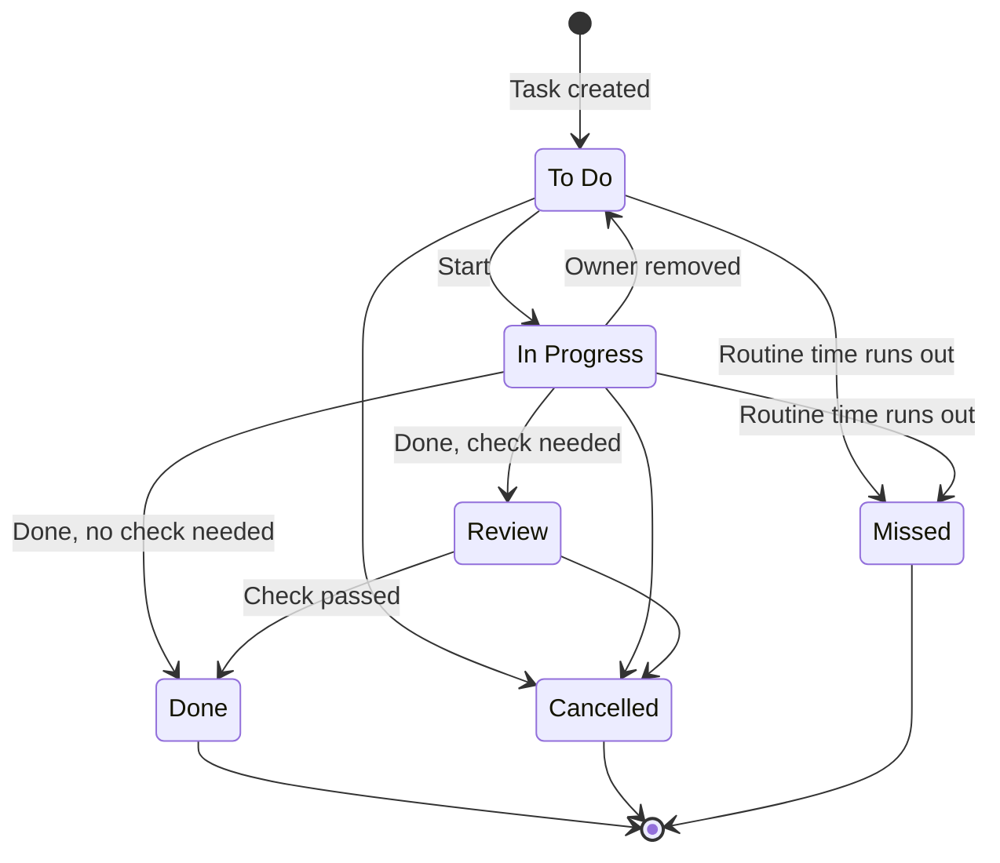

Figure 2. The life of a Task. Blocked and Need Help are markers on a Task, not steps. Missed is only for repeating daily work.

## Buttons employees use

| **Button** | **What happens** |
|----|----|
| Start | Moves the Task to In Progress and records it. |
| Done | Sends it to Review if a check is needed; otherwise marks it Done. |
| Need Help | Marks the Task as blocked and tells the lead. |
| Add Work | Asks the lead with a request, or adds a Task for yourself (Task for me). Neither needs a Goal or Deliverable. |
| Buttons in alerts | Start, Done, Need Help and Snooze in a push alert (and later in chat apps) do exactly what they do in the app. |
| My week | Says Room, Balanced or Full for this week, with an optional note, and shows it to the person's leads. |
| Request leave | Sends a leave request to the approver. Sick leave for today is approved right away. |

# 07 Planned and unplanned work

```text
  PLANNED WORK                        SURPRISE WORK
  (known before the week is locked)   (a new request or a problem)
        |                                   |
  Goal -> Deliverable                 Add Work -> Sort
  (estimate, assign, lock the week)   (decide how urgent, who, how long)
        |                                   |
        +-----------------+-----------------+
                          |
               ONE WAY TO DO A TASK
        To Do -> In Progress -> Review -> Done
                          |
  Update available time • Keep the locked plan • Measure delivery
```

Figure 3. Two ways in, one way to do the work.

## Three separate labels

| **Label** | **Examples** | **What it tells you** |
|----|----|----|
| Where it came from | Meeting, customer, manager, system alert | Where the request came from. |
| Kind of work | Bug, feature, support, operations | What sort of work it is. |
| Planned for this week? | In the locked plan, or added later | Whether it interrupted this week's plan. |

A reported bug can be part of a planned release. A new feature request can interrupt this week by surprise. "Planned or added" depends on a particular week, so the same Task can be added in one week and planned in the next.

## The locking rule

> **Lock the week's plan.**
>
> When the lead locks a week, HopFlows saves a copy of the planned work, the estimates and the owners. The live plan can still change, but reports always compare what really happened with that saved copy.

### Example: something urgent arrives midweek

1. Monday: the team locks 18 hours of planned work.
2. Tuesday: an urgent payment problem comes in. The lead checks it and estimates 5 hours.
3. The lead gives it to someone and may move less important work to later.
4. The report shows 18 hours planned, 5 hours added, and any work that was pushed back because of it.

If the same request is planned into next week, it counts as planned there, and HopFlows still remembers it started as a surprise.

### End of the week, and weeks that were never locked

At the end of a week, unfinished Tasks move to next week as "carried over" and appear in the weekly review. The lead can remove them before locking the new week. If a week is never locked, there is no saved plan: all its work counts as unplanned, and the weekly review points out that the week wasn't locked.

### Repeating daily work in the plan

When the lead locks a week, that week's routines are included automatically, so the plan, the Workload view and the reports all include routine time. A routine created after the week is locked counts as added work.

# 08 Step-by-step flows

Each flow below has a short diagram. Diagrams show the idea of the flow, not screen design.

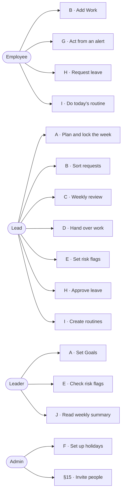

Figure 4. Who starts which flow.

## Flow A — Planned work

1. Leaders set a Goal with a target number and an end date.
2. A lead creates a Deliverable linked to the Goal, the products and the responsible department.
3. The lead breaks it into Tasks, gives each one an owner and estimates the time.
4. The weekly planner checks available time; the lead changes scope or timing if needed.
5. The lead locks the week, which saves the plan.
6. Employees work from their Today screen; progress shows up for the lead and the leaders.
7. The Deliverable is checked against its "done" test. The Goal's result number is updated separately.

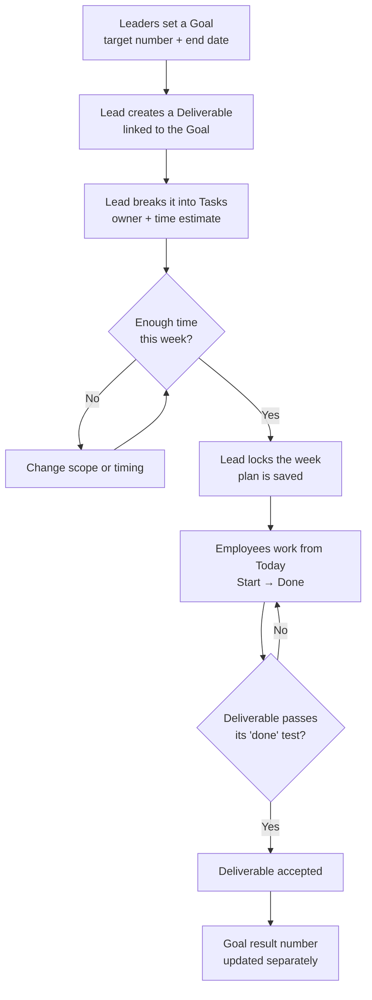

Figure 5. Flow A, planned work.

## Flow B — Surprise work

1. Anyone adds a request quickly, with optional details or photos, and can mark it "Seems urgent".
2. The request goes into the Incoming Queue. The lead checks how urgent it is ("Seems urgent" is only a hint), looks for duplicates and decides what to do.
3. The lead closes it, postpones it, merges it with an existing Task, or turns it into a Task. A postponed request comes back to the queue on its date. If it is merged into a Task that is already Done or Cancelled, the lead is asked to reopen that Task or make a new one.
4. The new Task follows the same steps as planned work.
5. If needed, the lead changes priorities and writes down why.
6. Time spent, status, completion and the effect on the original plan all stay visible.
7. The person who sent the request is told each decision in the same place they sent it, in plain words, for example: "Your request is now a Task for Dara", "Joined with an earlier report", "We'll look at it again on 3 November" or "Closed: already fixed". They are told again when the work is Done.

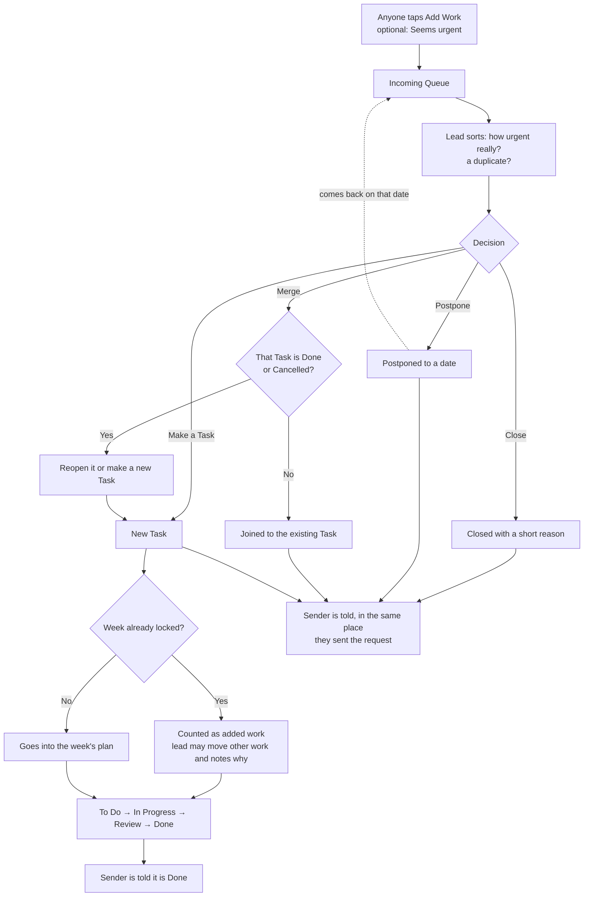

Figure 6. Flow B, surprise work.

## Flow C — Weekly review

At the end of the week, the lead looks at what was planned, what got done, what was carried over, how much surprise work came in, and what changed. The company can then adjust the buffer and priorities based on real demand, instead of assuming unfinished work means someone performed badly.

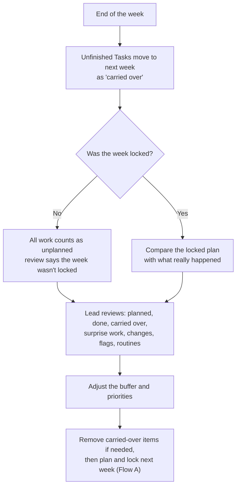

Figure 7. Flow C, weekly review.

## Flow D — Handover (leave or leaving)

1. A lead starts a Handover for a team member and picks the reason (leaving, long leave, new role, or balancing work), the start date, and whether it is permanent or temporary.
2. HopFlows lists everything the person still owns: open Tasks, Deliverables they lead, Goals they own, requests waiting to be sorted, departments they lead, products they own, meetings they organize, routines they do and team chats they added, with due dates and this week's plan.
3. The lead picks one person to receive everything, or a person for each item. Each item can also be left with no owner, which puts it back in Ready to plan so nobody has to take work they have no room for. For each item, HopFlows shows how busy each possible receiver would be after the move (this week only at first; future weeks once the Workload view covers them), suggests whoever has the most room, and warns if they would be too busy or are on leave when the work is due. The receiver must be another active team member.
4. When the lead confirms, everything moves at once. The new owners get the background (status, blockers, recent comments) and the old owner is told. For 10 minutes afterwards the lead can undo the handover: everything goes back to the old owner and everyone involved is told. (Proposed)
5. Locked plans don't change. The move is recorded as a handover, so reports show the work as "reassigned", not "missed" or "pushed back".
6. For a temporary handover (later stage), the department's current lead is reminded on the return date to give the work back, keep it with the new owner, or extend the date.
7. When someone is leaving, their account can be deactivated only after everything they own has been handed over or cancelled.

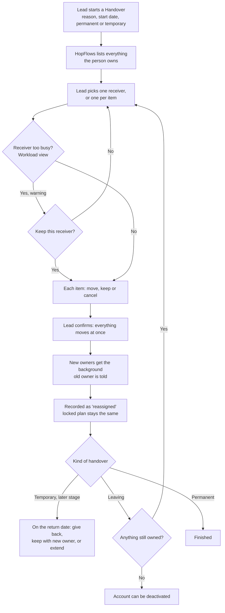

Figure 8. Flow D, handover.

## Flow E — Risk flags

1. A lead marks a Deliverable (or a Goal owner marks a Goal) At risk or Off track in one tap, picks a reason type, adds a short note and, if they want, a date by which things should be back on track.
2. In a later stage, HopFlows may suggest a flag when it notices warning signs: a Task blocked for several days, an owner on leave, overdue work, or a Goal number going the wrong way. The lead decides whether to accept it.
3. Each Goal shows the most serious flag from itself and its Deliverables. Leaders can filter Goals by flag, product and department, and see the reason and how long the flag has been there. On a Goal's page the flag shows its reason, note, who set it and when, and the back-on-track date, with a button to ask that person for an update. Whether the result is on pace for its target is shown separately from the flag, in one plain sentence on the Goal card and page, for example "Result ahead of pace; launch date at risk (payment keys late, back by Fri 23 Oct)." When a Goal has more than one open flag, its page lists them all, most serious first, each with its own Ask or Clear.
4. If a flag isn't looked at for a while (see §14), the lead is asked to confirm or clear it. Flagged items appear in the weekly review.
   A flag on a Goal or its Deliverables that stays open for 3 weeks also goes to leaders as a decision, with choices such as lending people, moving the date or waiting. The answer goes to the owner, and the flag stays until they update the plan.
5. Clearing a flag needs a short note. The person who set it, the item's owner, or leaders can clear it; a Goal owner can't clear a flag set by leaders. All past flags stay available to learn from.

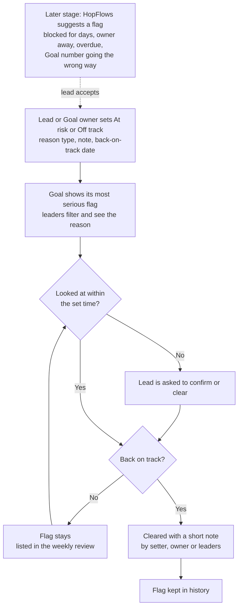

Figure 9. Flow E, risk flags.

## Flow F — Calendar

1. An admin sets up the company holiday calendar for the year: they load the national public holidays and add company days off. People follow the company's main calendar or an assigned regional one.
2. Anyone can create a meeting or event with a time, invited people, a "who can see it" setting and an optional link to a Goal, Deliverable or Task. Invited people answer Yes, Maybe or No.
3. Deadlines from Goals, Deliverables and Tasks show up automatically. Each person sees their own, leads also see their team's, and leaders see Goal and Deliverable dates.
4. Holidays and accepted events marked "Blocks work time" lower available time for the people involved. The weekly planner and the Workload view show this before the week is locked.
5. If a due date falls on a holiday or on the owner's leave, HopFlows warns at the moment the date is set and suggests the working day before. The person setting the date decides.
6. During or after a meeting, Add Work turns follow-ups into requests marked "from a meeting" and linked to it.
7. Reminders arrive before events and deadlines, following each person's alert settings.

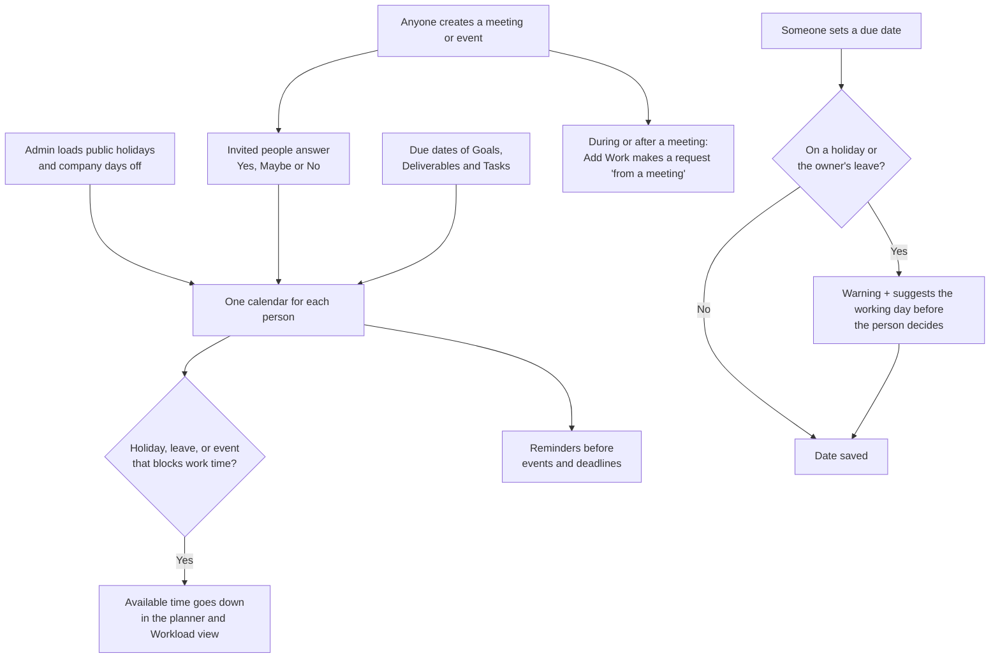

Figure 10. Flow F, calendar.

## Flow G — Alerts

1. After signing in, a person allows push alerts on their phone and in their browser.
2. When something happens (a new task, an urgent request, a meeting change, a deadline, a handover), HopFlows creates one alert, puts it in the in-app Inbox and sends it by push, following the person's settings.
3. Urgent alerts go out right away, even during quiet hours. Normal alerts wait until quiet hours end. Less important updates go into the morning summary.
4. The person acts from the push alert (Start, Done, Need Help, Snooze, Accept or Decline). Anything more complicated opens the right screen in the app.
5. If nobody acts on an urgent alert in time, it is sent again, then passed along: to the responsible lead, then the person covering for them, then the lead above, then an admin. Anyone who is the original person, on leave or no longer active is skipped.
6. Later stage, chat apps: a person taps Connect Telegram, Slack or Microsoft Teams, and a one-time link opens the HopFlows bot, which confirms the account. The same alerts and buttons then also arrive in that chat app, and the bot replies with the result. A lead can add the bot to the team's group and pick what it posts: morning summary, holidays, wins and urgent alerts. Sending a text or photo to the bot creates a new request, with the photo attached.

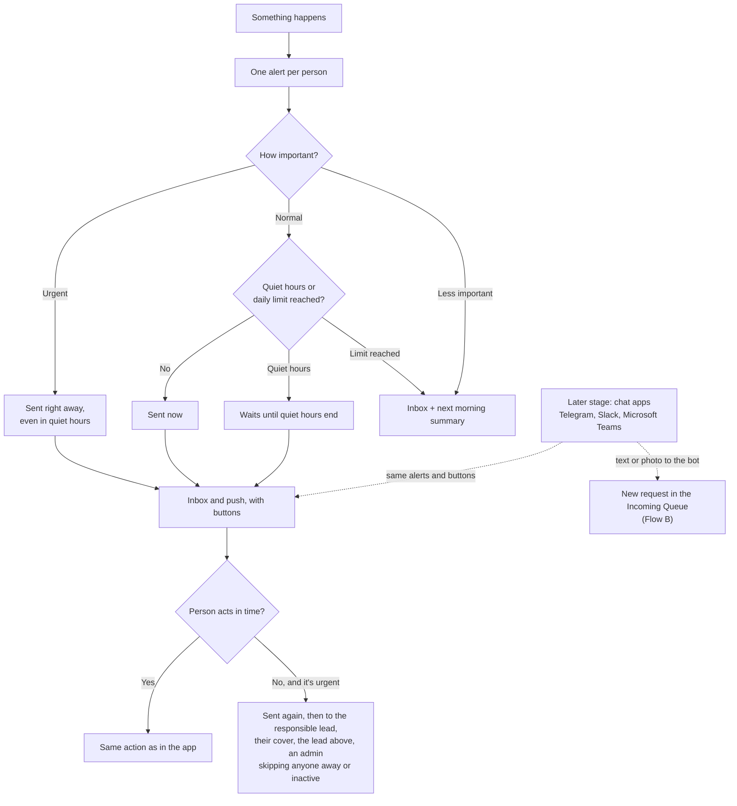

Figure 11. Flow G, alerts.

## Flow H — Leave (Proposed)

1. A person taps Request leave, picks the dates and type, and can add a reason.
2. The approver gets the request with Approve and Decline buttons in the app and in a push alert. Before approving, they see what the leave changes: the person's time to plan and planned work for that week, before and after, and each Task due on those days, with a choice to give it to someone with room or move it to a later week. Approving applies those choices and tells the people involved. (Proposed)
3. Once approved, the days show as Away and available time goes down. HopFlows lists the Tasks due during the leave so the person and lead can move them or give them to someone else. Leave longer than the long-leave limit asks the lead to start a Handover.
4. Sick today: the person taps "Sick today", no approval is needed, and the lead is told right away.
5. Cancelling approved leave gives the time back. Changes after the week is locked show in the weekly review.

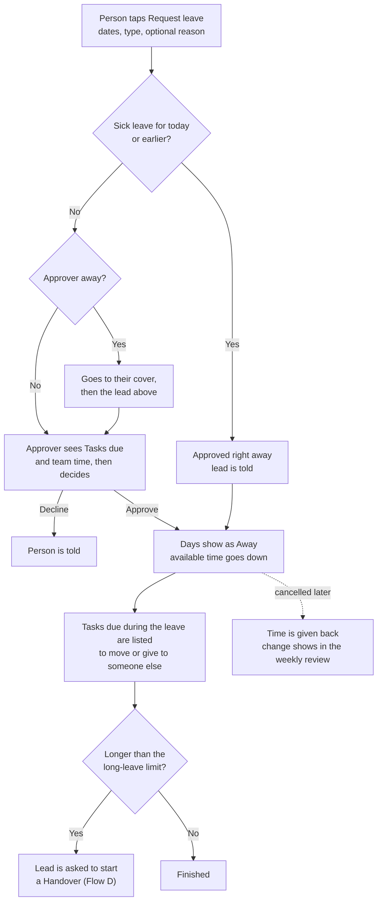

Figure 12. Flow H, leave.

## Flow I — Repeating daily work (Proposed)

1. A lead creates a routine (for example, "Open the shop checklist", working days, done by 09:00) and gives it to one person or a rotation.
2. Each working day, it appears in that person's Today screen under "Routine today" and in their morning summary.
3. The person ticks the checklist and marks it Done, with or without internet. Finishing a routine counts for the streak like any other Task.
4. If time runs out first, it closes as Missed. The lead sees the department's routine completion rate in the weekly review and reports, never as a ranking of people.

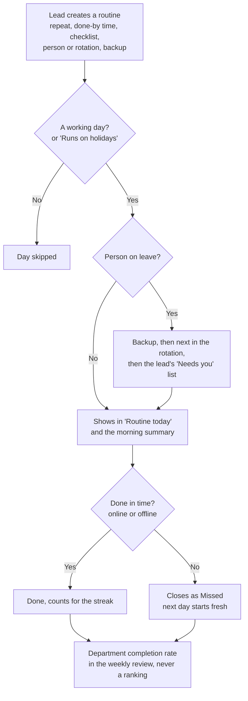

Figure 13. Flow I, repeating daily work.

## Flow J — Weekly summary for leaders (Proposed)

1. Every Monday at the morning summary time, each leader gets one summary in the app, as a push alert, plus a PDF.
2. The summary answers one question: are we on track with our Goals? It shows Goals by status (On track, At risk, Off track) and what changed since last week, new and cleared risk flags with reasons, Deliverables finished, updates to Goal results, how much work was unplanned in each department, and at most three decisions waiting for leaders.
3. Each line opens the item in the app. The summary never shows individual Tasks or how busy individual people are.
   Every flag line names who to ask. Each decision opens where it can be made. Decisions waiting are also the first thing on the leader's Goals page:
   - To approve a Goal, the leader sees its result, date, product, planned Deliverables and the proposer's note, then picks Approve or Send back with a note.
   - For a date-or-scope question, the leader sees both choices and what each one changes. The answer goes to the person who asked, and the risk flag stays until they update the plan.
   - Each decision can be undone straight after it is made.
4. If Monday is a holiday, the summary comes on the next working day.

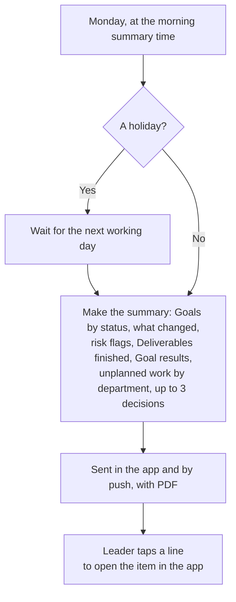

Figure 14. Flow J, weekly summary for leaders.

# 09 What each role sees and can do

## Main screens

| **Screen** | **What it shows** | **What you can do** |
|----|----|----|
| Leaders: Goals | Results, deadlines, risk flags, progress by product | Set priorities, approve Goals, look at risks and performance |
| Leads: Needs you | What is waiting on them (new requests, reviews, Need Help, leave to approve), this week's team colours, Deliverables at risk | Sort requests, approve leave, plan and lock the week, assign, hand over work, change scope |
| Employees: Today | Top three priorities, next step, due dates, help needed | Start, Done, Need Help, add work, My week, request leave |
| Everyone: Calendar | Holidays, meetings, events and deadlines; leads also see team deadlines and leave | Create events, answer invites, open or move work |

Managers also get their own Today screen. Different roles get different starting screens, not three separate apps, and nobody is locked out of moving around.

## Simple by default: one question per role

HopFlows holds a lot of information, but nobody should have to dig through it. Each role's home screen answers one question and shows only what the person needs to act. Everything else is still there, one tap away. The test for anything on a home screen: does this person need it to decide what to do next? If not, it moves one tap deeper.

| **Role and question** | **On the home screen** | **One tap away** |
|----|----|----|
| Employee — "What should I do next?" | Top three priorities, Routine today (folded checklist), today's meetings, deadlines in the next two days, Start / Done / Need Help, add work, private streak | Full task list, Requests I sent, leave, Goals and Deliverables, other people's work, reports, time numbers |
| Lead — "Is my team OK, and what needs me?" | A "Needs you" list (new requests, reviews, Need Help, leave to approve, people who say they're Full, routines with nobody to do them, flags to check), this week's team colours, Deliverables at risk | The hours behind each colour, full Deliverable lists, history, detailed measures |
| Leader — "Are we on track with our Goals?" | Goals with results and risk flags, by product, and the latest weekly summary | Deliverables, Tasks, team workload, history |

- One main action per screen. Lists show three to five items, with "See all" for the rest.
- The mobile app has four tabs: Home (different per role), Calendar, Inbox and a big Add button in the middle. Everything else is in Menu. Search sits at the top of every screen, not in a tab.
- Routine work never competes with the top three priorities. It sits in its own folded "Routine today" group, and the "All clear" moment counts only the top three.
- Words and colours before numbers: short labels like "On track" or "Needs you" and colour bands come first. Hours and percentages appear on tap.
- Plain words for employees: "Planned this week", not "baseline"; "Add Work" and "New request", not "intake"; no planning jargon on employee screens.
- Features appear only when useful: risk-flag buttons only on Goals and Deliverables the person owns, Handover only from a team member's menu, and the Workload view only once the team has estimates.
- Setup is done by admins and leads, with good starting settings. An employee's first visit never starts with settings.
- The Calendar opens with what each role needs: employees see holidays, their meetings and their deadlines; leads also see team deadlines and leave; leaders see Goal and Deliverable dates and holidays.
- Fun only at natural moments: Punh Punh and celebrations appear at first sign-in, when work is finished and at the end of the day, never between a person and their next action.
- Short labels in English, with room for longer translations, so phone screens don't get crowded when other languages are added.
- One in, one out: every new feature must say which role sees it on their home screen. If it adds something there, something else moves one tap deeper.

## Ways to see work: List, Board and Table (Proposed)

Any full list of work (My tasks, a Deliverable's Tasks, a team's Tasks, the Incoming Queue and routines) can be seen three ways. A small switch at the top changes the view. Home screens stay as they are: the switch appears only after "See all".

| **View** | **Best for** | **How it works** |
|----|----|----|
| List (default) | Quick daily use, especially on a phone | One item per row with title, owner, due date and status. Same as today. |
| Board | Seeing how work is moving | One column per step: To Do, In Progress, Review, Done. Each Task is a card showing its owner, due date, and markers for Blocked, Need Help and Confidential. For the Incoming Queue, the columns are New, Postponed and Sorted. |
| Table | Checking many items at once | One row per item, with columns that can be shown, hidden and sorted: title, owner, status, due date, size, Deliverable, department, product, kind of work, where it came from, planned or added this week. Filters at the top. |

- **Same rules everywhere.** Dragging a card on the Board is the same as pressing the button. Dragging to Done sends the Task to Review when a check is needed. Only the owner or the lead can finish it; a helper who drags it is offered "Ask owner". Dragging a card into a locked week is recorded as a plan change.
- **Grouping.** The Board and Table can be grouped by owner, Deliverable, department or priority, so a lead can check one person's or one Deliverable's work in seconds.
- **Changing many at once (Table, leads only).** A lead can tick several rows and change the owner, due date or week together. Each change follows the normal rules and history. If some rows can't be changed (for example, a Task the lead can't edit), HopFlows changes the rest and lists the ones it skipped, with the reason.
- **Hidden by default.** Cancelled Tasks and Missed routines are hidden on the Board and in the Table unless the person turns them on, so the views stay clean.
- **On a phone.** The Board scrolls sideways one column at a time. The Table shows the three most useful columns and the rest on tap. Leads will mostly use the Table on a computer.
- **Remembered.** HopFlows remembers each person's last view, filters and columns for each screen.
- **Permissions.** Every view shows only what the person may see. A Confidential Task shows only to people with access.
- **Downloads.** What the Table shows can be downloaded to Excel, following the same rules as reports (§10).

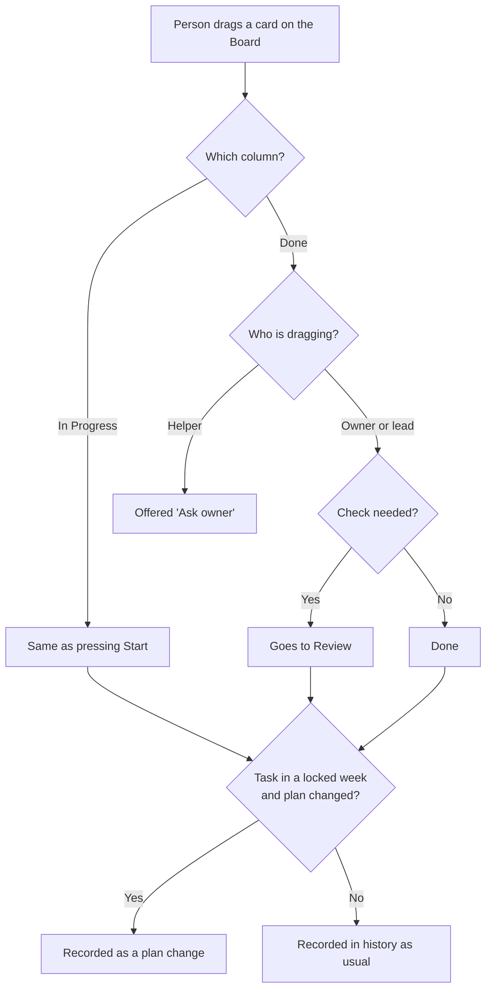

Figure 15. Dragging on the Board follows the same rules as the buttons.

## Workload view

A planning screen for leads that answers one question: who has room, and who has too much, this week and in the coming weeks? Each row is a person in the lead's departments. Each column is a week: this week and the next three (the number can be changed). The first version shows this week only; later weeks come in a later stage. Each box shows how busy the person is as a colour, with the hours shown on tap.

| **Colour** | **Meaning** | **Starting rule** |
|----|----|----|
| Room | Can take more work | Total work is under 70% of their time to plan. |
| Balanced | A healthy amount | Total work is 70–100% of their time to plan. |
| Using buffer | Surprises are eating into the buffer | More than their time to plan, but still within available time. |
| Too much | More work than time | More than their available time. |
| Away | Not available | Leave or time off covers the whole week. |

- The colours are based on estimates (planned work plus added work, compared with time to plan and available time) and say so until people log real time.
- From any box, the lead can open the Tasks behind it and give them to someone else or move them. Changes are recorded the same way as in the weekly planner.
- Someone in more than one department appears once, with their total and a split by department, so nobody is counted twice.
- People are sorted by team and name, never by how busy they are. Teammates never see each other's colours. Employees see only their own. Leaders see department totals, and see individual people only if they have the "See team time" right.
- The "Room" level can be changed per department. The other colours follow from the time settings.
- If someone has no time to plan but has work, the box shows "Too much", not "Away".
- Tasks with no estimate are shown as a number next to the colour, not counted as zero hours.
- Work moved by handover never counts as missed for either the old or the new owner.
- A person's own week status (Room, Balanced or Full) shows as a small marker next to the colour. If they disagree, for example "Full" in a "Room" box, both are shown and the lead's "Needs you" list asks them to look. (Proposed)

## Risk flags for leaders

Progress numbers tell leaders what has already happened. A risk flag tells them what someone close to the work expects to happen. HopFlows shows both and never lets one hide the other.

| **Level** | **Meaning** | **Who can set it** |
|----|----|----|
| On track (no flag) | Normal. No worries right now. | Clearing a flag brings the item back here. |
| At risk | The date or result might be missed unless something changes. | Deliverable lead; Goal owner; leaders on any Goal. |
| Off track | The date or result will be missed unless someone decides to change scope, date or people. | Deliverable lead; Goal owner; leaders on any Goal. |

- Each flag has a reason type (Time, Waiting on others, Scope change, Quality, Outside the company, Other), a short note and an optional "back on track by" date, so leaders see the cause without opening Tasks.
- A Goal shows the most serious flag from itself and its Deliverables, with a count. Leaders can filter Goals by flag, product and department.
- Flags go on Goals and Deliverables, not on people or Tasks. Tasks have the "Blocked" marker and the Need Help button. Employees raise worries that way, and the lead decides whether a flag is needed.
- If a flag disagrees with the numbers (for example, At risk even though every Task is on time), both are shown side by side and the flag stays.
- In a later stage, suggested flags are never set automatically. Flags not looked at for a while (see §14) remind the lead to confirm or clear them.

## Calendar

One calendar for everyone, with all the dates that affect their work: days off, meetings, events and deadlines. It has Month, Week and List views, and each layer can be turned on or off.

| **Layer** | **What it shows** | **Who sees it by default** |
|----|----|----|
| Holidays | Public and company days off from the person's holiday calendar | Everyone |
| Meetings | Meetings with invited people, their answers and an optional link to work | Invited people; the department or company when shared |
| Events | Personal or team events like training, trips or reminders | The creator, or the chosen department or company |
| Deadlines | Due dates of Tasks, Deliverables and Goals, with status and risk flag | Same people who can see the item |
| Leave | Shown as "Away" | The person; leads for their teams |

- Deadlines can be filtered to Mine, My team, or Goals and Deliverables. Overdue items stand out, and Deliverable and Goal deadlines show their risk flag, so leaders see dates at risk without opening anything.
- Dragging a deadline changes the item's due date only if the person is allowed to edit it. Otherwise HopFlows offers to send a change request to the owner.
- Private events show to others as "Busy" for that time. Their title and details are never shown.
- The employee Today screen lists today's meetings and deadlines for the next few days next to the top three priorities.
- Times show in each person's local time. Holidays and all-day events stay as dates.

## Alerts and the mobile app

Alerts are how HopFlows reaches people where they already are. The mobile app with push alerts is the main channel, with browser alerts on computers. Chat apps (Telegram, Slack and Microsoft Teams) come in a later stage and get the same messages and buttons. Messages are short, friendly and easy to act on, and urgent ones are impossible to miss.

| **What happened** | **Priority** | **How it's sent by default** |
|----|----|----|
| Task given or handed over to you | Normal | Push, with Start and Open |
| Urgent request or problem given to you | Urgent | Push right away; passed to the lead if nobody acts |
| Someone pressed Need Help | Urgent | Push to the responsible lead |
| Your request was sorted or finished | Normal | Same place the request came from, plus Inbox |
| Review needed | Normal | Push, with Open |
| Leave request | Normal | Push to the approver, with Approve / Decline |
| Leave decided, or sick leave added | Normal | Push to the person and their leads |
| Team member says they're Full this week | Normal | Lead's "Needs you" list and Inbox; no push |
| Routine with nobody to do it (owner and backups away) | Normal | Push to the lead |
| Meeting invite, change or cancellation | Normal | Push, with Accept / Decline |
| Meeting starting soon | Normal | Push 10 minutes before |
| Deadline today or tomorrow | Daily summary | Morning summary; push on the day if still open |
| Task overdue | Normal | One push, then listed in the morning summary |
| Holiday coming up | Daily summary | Morning summary the day before; team group too, once chat apps are added |
| Risk flag set or cleared | Normal | Push to the Goal owner and leaders |
| Work accepted or team milestone | Celebration | Personal kudos; team group post once chat apps are added |
| Weekly team wins | Celebration | In the app on Friday afternoon; team group too, once chat apps are added |
| Weekly summary for leaders | Daily summary | App and push on Monday, with PDF |

- Morning summary: one message at the summary time (see §14), in the person's time zone, on working days. It lists the top three priorities, today's meetings, deadlines in the next two days and upcoming holidays. No summary on holidays or leave.
- Fun, not noisy: a friendly Punh Punh voice, a little emoji and short celebrations for finished work and team milestones, in English by default, with other languages as they are added. Celebrations follow the rules in §11 (only for real finished work, team before individual, no rankings in group chats). Urgent alerts are always plain and clear.
- Hard to miss: urgent alerts have their own sound, are never bundled, and ignore quiet hours (see §14). Everything else waits.
- Daily push limit: there's a limit on normal push alerts per person per day (see §14). Extra alerts go to the Inbox and the next morning summary. Urgent alerts have no limit.
- Each person picks channels for each kind of alert. The company sets the starting choices and can turn a channel off or limit what outside apps receive.
- Chat apps (Telegram, Slack and Microsoft Teams, later stage) will all use the same messages, buttons and team chat settings.

## Search (Proposed)

- One search box at the top of every screen finds Tasks, Deliverables, Goals, requests, routines, people and events.
- Before typing, it shows recently opened items and the person's own open work, so most of the time no typing is needed.
- Results are grouped by type, show status and owner, and can be filtered by type, status, person, department and date.
- Results follow the "who can see it" rules: a Confidential Task appears only to people allowed to see it.
- Without internet, search looks through the items saved on the phone, and says so.

## Working offline (Proposed)

The mobile app is built for weak internet. Without a connection, a person can:

- Open Today, Routine today, their Tasks, the calendar for the next seven days and recent search results.
- Use Add Work (with photos) and request leave.
- Start a Task, mark it Done, tick checklist steps and finish routines.

A small banner says "Offline — saved, we'll send it when you're back online", with Punh Punh's calm pose. Sorting requests, locking a plan, handovers, approvals and risk flags need internet, because they depend on the latest information. When the connection comes back, saved actions are sent with the time they really happened, so routine deadlines and streaks are judged fairly. If an action no longer makes sense, the app explains why in plain words, and nothing added is lost.

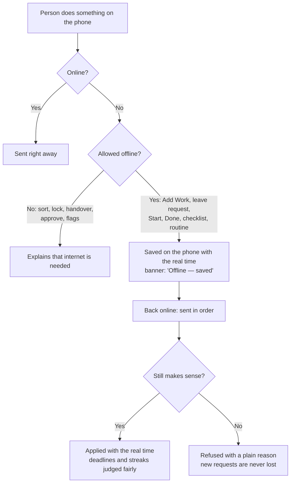

Figure 16. Working offline.

## Who can do what (starting settings)

| **Action** | **Leaders** | **Leads** | **Employees** |
|----|----|----|----|
| Set company Goals | Yes | Suggest, or if given the right | No |
| Manage Deliverables | If given the right | Their own area | No |
| Give Tasks to people | If given the right | Their own area | No, unless allowed |
| Add a Task for themselves | Yes | Yes | Yes |
| Update their own Tasks | Yes | Yes | Yes |
| See other departments' work (read-only) | Yes | Yes | Yes |
| Send a request | Yes | Yes | Yes |
| Sort their department's requests | If given the right | Yes | No |
| See company-wide reports | Yes | Only if allowed | Only their own |
| See team time | Yes | Their teams | Their own |
| See the Workload view | Yes | Their teams | Their own only |
| Hand over someone's work | If given the right | Their own area | No |
| Set At risk / Off track | Yes | Their own Goals and Deliverables | No (use Need Help) |
| See risk flags | Yes | Their own area | Flags on their own work |
| Manage holiday calendars | Yes (admin) | No | No |
| Manage products, product areas and departments | Yes (admin) | No | No |
| Close a department's work to other departments | Yes (admin) | No | No |
| Create meetings and events | Yes | Yes | Yes |
| See the team calendar (deadlines, leave, shared events) | Yes | Their teams | Their own calendar and shared events |
| Change a deadline from the calendar | Their own Goals, or if given the right | Their own area | Their own standalone Tasks; otherwise ask |
| Connect their own chat account (later stage) | Yes | Yes | Yes |
| Connect a team chat group (later stage) | Yes | Their own departments | No |
| Set company alert and channel rules | Yes (admin) | No | No |
| Give kudos | Yes | Yes | Yes |
| Request their own leave | Yes | Yes | Yes |
| Approve leave | For leads under them | Their own departments | No |
| Set their own week status | Yes | Yes | Yes |
| Create routines | Yes | Their own departments, and personal ones | Personal ones only |
| Run and download reports | Yes | Their teams | Their own only |
| Change many Tasks at once (Table) | If given the right | Their own area | No |
| Get the weekly summary for leaders | Yes | Optional, for their own area | No |
| Set up rewards and fun features | Yes (admin) | No | No |

These are starting settings. A company can give a specific right to a named person. Confidential Tasks have their own "who can see it" rules on top of department and job title.

# 10 Time and measures

## Talking about time

Keep these separate: total working hours, time off, buffer for surprises, the time planned at the start of the week, time actually logged, and new work coming in (see "Words about time" in §03). When nobody has logged real time, clearly label numbers as estimates.

| **Example week** | **Hours** |
|---|---|
| Working week | 40 |
| Meetings and other time off | 8 |
| Available time | 32 |
| Buffer for surprises | 8 |
| Time to plan | 24 |
| Surprise work that came in | 6 |

In this example, 24 hours of planned work plus 6 hours of surprise work makes 30 hours, against 32 available hours. Part of the buffer is used, but the person is not over their time.

Holidays and leave reduce the working week before this calculation. For example, a public holiday on Tuesday cuts the working week to 32 hours for everyone on that holiday calendar, and the weekly planner shows the lower number before the week is locked.

## Measures

| **Measure** | **What it means** |
|----|----|
| Planned load | Hours locked into the week ÷ time to plan, per person and department. |
| Surprise work | Time spent on work added after the week was locked. Estimated until real time is logged. |
| Surprise share | Surprise work ÷ all work in the week (planned work still in the week, plus added work). |
| Estimate accuracy | Logged time ÷ estimate, only for Tasks that have both. |
| Promises kept | Locked Tasks Done by the end of the week ÷ locked Tasks. Tasks cancelled by a lead or moved by handover don't count. Reopened Tasks count by their status at the end of the week. |
| Work pushed back | Locked Tasks and hours removed from the week or moved later, where the reason names new work. |
| Goal result | The latest real number compared with the starting point and target, separate from finished Tasks. |
| Time used | Total work or logged time ÷ available time. Not a score of how good someone is. |
| Busyness | Total work ÷ time to plan, for one person and one week. Shown as a colour in the Workload view. For planning only, not a score. |
| Reassigned work | Tasks and hours moved by handover or rebalancing, shown separately from pushed-back and missed work. |
| Risk level | Share of active Goals and Deliverables marked At risk or Off track, by product and department, with how long flags have been active on average. |
| Request turnaround | Time from a request being added to being sorted, and to being Done, by department and by where it came from. |
| Routine completion | Routines Done on time ÷ routines due, by department and routine. Never ranked by person. |

Any measure based on estimates is labelled "Estimated" until people log real time. Cancelled work is shown separately and never counts as missed.

## Standard reports (Proposed)

Four reports come with the first version. Each opens on screen and downloads as Excel or PDF for board meetings.

| **Report** | **For** | **What it answers** |
|----|----|----|
| Plan vs. reality | Leads, leaders | For each department and week: planned, added, done, carried over, pushed back and reassigned work, each with reasons. |
| Goal status | Leaders | Each Goal's result so far, its risk flag and reason, and its Deliverables' status and dates. |
| New requests | Leads, leaders | Requests by where they came from and kind of work, what was decided, how fast, and problems reported more than once. |
| Workload and routines | Leads, leaders | Department colours by week, surprise share, routine completion and leave days. Individual details only with the "See team time" right, and never ranked. |

Employees get one personal report, **My week**, with their own planned, added and finished work.

Leaders open Reports on the company view: Goal status first, then plan vs. reality by department. Leads open the same reports for their own department.

## Keeping it fair

- An hour isn't always the same amount of difficulty or value. Offer simple Small / Medium / Large sizes, with hours optional.
- Never use logged time to rank employees, and never pretend estimates are real logged time.
- Record why tasks move: surprise problems, changed priorities from leaders, waiting on others, leave, or a wrong estimate.
- In company-wide reports, count people in several departments only once.
- Don't count a Deliverable that covers several products twice. Use its main product, or set shares.

# 11 Rewards, fun and the mascot

Rewards help people adopt the app. They should follow real, checked work, and should never encourage splitting tasks, working extra hours or saying work is done when it isn't.

## Start simple (first version)

The first version keeps rewards small, positive and private. Finishing work should feel good and helping others should be noticed, without points to chase or anything to compete over.

| **Feature** | **How it works** | **Safety rule** |
|----|----|----|
| Celebration | A short animation in the app (and a friendly Punh Punh message in chat apps, once added) when work is accepted as Done, and a small "All clear" when the day's top three priorities are finished. | Only when work is accepted, not on every status change. Reopened work doesn't celebrate twice. |
| Streak | Counts working days on which the person finishes a Task or a checklist step. | Weekends, holidays and leave never break it. One missed working day per week is forgiven. One action a day is enough, so splitting work earns nothing extra. Only the person can see it. |
| Kudos | A one-tap thank-you to a teammate from a Task or a comment (and later from a chat app). | Only for people who worked on or helped with that item. Shown to the person and their lead, never ranked. |
| Weekly team wins | A Friday post in the app (and the team's chat group, once chat apps are added) listing finished Deliverables, milestones and how many kudos the team gave. | Team only; no individual counts or comparisons. |

- No points, badges or leaderboards in the first version.
- The company can turn off each feature, and each person can mute it.
- Celebrations and streak days come only from real, checked events, each counted once, so repeating or undoing actions can't be used to game them.

## Mascot: Punh Punh

HopFlows needs a mascot inside the app, not only in marketing. Punh Punh is the friendly face of the product: it welcomes new people, fills empty screens, celebrates real wins and, once chat apps are added, gives the chat bot a personality, so the app feels light and welcoming. Punh Punh is a short, chubby pencil: a striped yellow body, a cream sharpened tip with a rounded pencil point on top, and a pink eraser at the bottom. A pencil fits "Small steps. Big wins.": every task is a small mark on the page, and the ticked note it holds is the moment work is Done.

|  |  |  |
|:--:|:--:|:--:|
| Welcome, first steps | Hello, empty screens | Done, "All clear" |

Colours, the original artwork and all six poses (each facing left and right) are in `design/mascot/README.md`.

| **Moment** | **What Punh Punh does** | **Rule** |
|----|----|----|
| First steps | Welcomes new people and walks them through their first Task in a few steps. | Can be skipped at any step. |
| Empty screens | Replaces an empty Today, Inbox or Calendar with a short, friendly message and one next step. | Never hides real content. |
| Celebrations | Plays a short celebration when work is accepted and when the day is "All clear". | Short, silent by default, and respects "reduce motion" settings. |
| Morning summary and chat bots | Signs the morning summary, and bot messages once chat apps are added. A Punh Punh sticker set is used for kudos and team wins in chat. | Same personality in every language. |
| Streak and kudos | Appears next to the private streak and presents kudos received. | Never sad, never nagging; no reaction to a missed day. |
| Errors and offline | Shows a calm pose with a clear next step. | The message stays plain and exact. |

- Punh Punh never appears on urgent alerts, Need Help, risk flags, handovers or Confidential items. Those stay plain and serious.
- Punh Punh never judges or compares people: no sad faces for overdue work, and never in anything that ranks people.
- Anyone can turn off Punh Punh's animations for themselves, and the company can turn the mascot off for everyone.
- Design work for the first version: a character sheet, five main poses (welcome, celebrate, thinking, calm, resting for holidays and leave), light animations. A chat sticker set and the bot's profile picture come with chat apps, and seasonal outfits come later.

## App icon


The app icon is **Punh Checklist**: a white checklist card on a soft sky tile, with two items ticked and one still open, and a large Punh Punh in front of it, tilted 12° to the right, ready for the third. Punh Punh is drawn big so its face still reads at home-screen size. It says "to-do app" at first glance, and the open box is the next useful action, the same promise as the Today screen. Colours come from the Soft Bento design system and Punh Punh's own colours.

- Phones and app stores use the square version; iOS and Android round the corners themselves. The web app, documents and slides use the version with rounded corners.
- Android 8 and later use an adaptive version: the same art, smaller, on its own sky layer, so a circle or squircle mask never cuts Punh Punh. Android 13 themed icons use the plain ticked box.
- Phones show the app icon next to every notification, including urgent ones. That is the app's name badge, not Punh Punh joining the message, so the rule that keeps Punh Punh out of urgent alerts, Need Help, risk flags, handovers and Confidential items still applies to everything inside the alert. On Android, the small icon in the status bar is a plain white ticked box, with no Punh Punh.
- At browser-tab size (16–32px) the details blur into the shape and colours. That is enough to find the tab, but a simpler favicon may be drawn later.
- Don't recolour the icon, add text to it or place it on another tile colour.

Files are in `design/app-icon/`. The other logo options considered are in `design/archives/logo-options/`.

## More rewards (later)

Once teams use HopFlows every day, add more ways to recognize people, built on the same checked events.

| **Feature** | **Good reason to reward** | **Safety rule** |
|----|----|----|
| Team achievement | Milestones finished as agreed | Quality and teamwork over speed. |
| Problem solver | Important problems fixed and confirmed | Based on impact, not the number of issues. |
| Team player | Real, useful help to others | Don't reward empty comments or meaningless updates. |
| Leaderboard | Optional, for teams | Never rank individuals by hours or number of Tasks. |
| Seasonal themes | Light themes for New Year and other holidays | Looks only; never linked to performance. |

## Making it easy to start

- Quick adding, a short Today list, sensible alert settings and reaching people in the apps they already use are covered in §01 and §09.
- The Calendar puts holidays, meetings and deadlines in one place. Google and Microsoft calendar sync and other connections can later bring the work people really do closer to what is in the app.
- English and phone-friendly design are included from the start. Other languages can be added later.

# 12 Special cases

## Work and requests

| **Situation** | **What HopFlows does** |
|----|----|
| A Goal helps several products | Link the Goal to each product; don't copy the Goal. |
| Three departments share work | One Deliverable lead; the other departments help. |
| Surprise Task belongs to an existing Deliverable | Link it, and remember it was added after the week was locked. |
| Surprise Task has no Deliverable | Allow it as a standalone Task in the queue and on Today. |
| The same problem is reported many times | Link all the requests to one Task. |
| Confidential Task | Hide its details, whatever someone's role or team; give access person by person. |
| Someone opens another department's Task or Deliverable | Show it read-only with title, owner, status, due date and Blocked; offer Send a request and Give kudos; never show workload colours. |
| A department's work is closed by an admin | People outside it find none of its work in search, lists or links, and see no hint it exists. Shared Deliverables they help on stay visible. |
| Task reopened after review | Keep the earlier Done and review history; show how often work is reopened separately. |
| Owner removed from an In Progress Task | Move the Task back to To Do; active work always has an owner. |
| A helper marks a Task Done | Offer "Ask owner"; only the owner or the lead can finish it. |
| A Task waits on itself in a circle, or on another company's Task | Refuse it. |
| Request added without a department | Send it to the sender's main department, or else the company-wide queue. |
| Postponed request | Bring it back to the Incoming Queue on its date. |
| Request merged into a Task that is Done or Cancelled | Ask the lead to reopen the Task or make a new one. |
| The person who sent the request has left the company | Skip the update; the request keeps its history. |
| Request turned into a Confidential Task | Tell the sender the status only, with no title or details. |
| Request closed without a reason | Not allowed; closing needs a short reason the sender can read. |
| A helper drags a card to Done on the Board | Put the card back and offer "Ask owner". |
| A card is dragged to Done but needs review | Move it to Review instead, and say why. |
| A lead changes many Tasks at once and some can't be changed | Change the rest; list the skipped ones with the reason. |

## Planning and time

| **Situation** | **What HopFlows does** |
|----|----|
| Someone is in two teams | Split their time by their share in each department, changeable each week; never count them twice. |
| A Task runs across two weeks | Record its time and result in each week. |
| A Task changes owner | Remember who owned it when the week was locked and in each later period. |
| All Tasks done, but the Goal target not reached | Show the work as finished and the business result as not reached. |
| A week is never locked | No saved plan; count the work as unplanned and point it out in the weekly review. |
| Task unfinished at the end of the week | Carry it to next week; the lead can remove it before locking. |
| A locked Task is cancelled midweek | Record it as cancelled; leave it out of "promises kept" and show it separately. |
| Holiday added after the week is locked | Work out available time again; keep the locked plan and show the change in the weekly review. |
| Leave overlaps a holiday or a blocking event | Count the overlap once; available time never goes below zero. |
| A blocking event is declined after the week is locked | Work out the time again and show the change in the weekly review. |
| No time to plan, but work is assigned | The Workload view shows "Too much", not "Away". |
| People in different countries | Each follows their own holiday calendar and time zone; team screens show each person's holidays. |

## Handover and leave

| **Situation** | **What HopFlows does** |
|----|----|
| Someone is on leave | Lower their available time and pause their streak; offer a temporary Handover for their open work (later stage; the first version uses a permanent Handover). |
| Someone leaves with open work | Don't allow deactivation until every Task, Deliverable, Goal, department, product, meeting and team chat they own is handed over or cancelled. |
| Temporary handover during leave (later stage) | Move work to a cover person; on the return date, remind the department's current lead to give it back, keep it there or extend the date. |
| The receiver is leaving, inactive or the same person | Refuse; the receiver must be another active person not handing over their own work. |
| The receiver would have too much work | Warn using the Workload view; the lead can continue with a written reason. |
| Handover after the week is locked | Keep the locked plan; record a handover and show the work as reassigned, not missed. |
| Handover includes a Confidential Task | The receiver needs access first; otherwise the item waits for the lead to give access or decide. |

## Risk flags

| **Situation** | **What HopFlows does** |
|----|----|
| A flag disagrees with the numbers | Show both side by side; the lead's flag stays until cleared. |
| A flagged Deliverable under a Goal | The Goal shows the most serious active flag from itself and its Deliverables. |
| A flagged Deliverable is accepted, cancelled or moved | Close the flag on acceptance or cancellation, with that reason; move it with the Deliverable to a new Goal. |
| A Goal owner tries to clear a flag set by leaders | Not allowed; the person who set it, the item's owner (for flags not set by leaders) or leaders can clear it. |
| A flag is left alone | Remind the lead to confirm or clear it after the set time (see §14); never clear it automatically. |

## Calendar

| **Situation** | **What HopFlows does** |
|----|----|
| A deadline falls on a holiday or on leave | Warn when the date is set and suggest the working day before; never move it automatically. |
| One meeting in a repeating series changes | Change only that meeting; the rest stay the same. |
| A lead looks at someone's private event | Show "Busy" for that time only. |
| Deadline on a Confidential Task | Show it only to people who can see the Task. |

## Alerts and chat

Rows about chat apps apply once chat apps are added (later stage).

| **Situation** | **What HopFlows does** |
|----|----|
| Someone hasn't linked a chat app | Send by push and the in-app inbox; suggest connecting once, not again and again. |
| A chat bot is blocked, or push stops reaching a phone | Treat that chat or phone as disconnected, use the other channels, and show a "reconnect" message in the app. |
| A button is tapped after the Task changed | Check again; reply "Already done" or explain why the action no longer works. |
| A button is tapped by someone who lost access | Refuse and reply without showing any details. |
| Alert about a Confidential Task | Outside apps get only "You have a confidential update — open HopFlows", with no title or details. |
| The same event happens twice | Send it once; the person gets one message. |
| Someone is on leave or on holiday | Hold normal and summary alerts until they're back; urgent alerts go to their handover person or lead. |
| The next person for an urgent alert is the same person, on leave or inactive | Skip to the next person in line (lead, the person covering for them, the lead above, admin). |
| An urgent alert is snoozed | Snooze can only delay it until the time it would be passed on; it is still passed on. |
| A team chat includes people outside HopFlows | Post team summaries only; personal actions happen in private messages. |
| One chat account is linked to a second HopFlows person | Refuse; one chat account links to one person. |
| Someone in two companies adds a request from a chat app | The bot asks which company and offers to remember the answer. |

## Leave, routines and week status

| **Situation** | **What HopFlows does** |
|----|----|
| The leave approver is away | Send the request to the person covering for them, then to the lead above. |
| Leave approved after the week is locked | Work out the time again, keep the locked plan and show the change in the weekly review. |
| Approved leave covers Tasks with due dates | List them for the person and lead to move or give to someone else; never change dates automatically. |
| Sick leave added after the fact | Accept past dates; work out the time again and protect the streak for those days. |
| A leave request overlaps existing leave | Refuse the overlap and show the existing leave. |
| The routine's owner is on leave | Give that day to the backup, then the next person in the rotation, then the lead's "Needs you" list. |
| A routine falls on a holiday | Skip it, unless the routine runs on holidays. |
| A routine isn't done in time | Close it as Missed; don't carry it forward. |
| A routine is changed | Change future days only. |
| Week status from someone on leave all week | Not offered; the box already shows "Away". |
| Someone says "Full" but the colour shows "Room" | Show both; ask the lead to look in "Needs you". |

## Reports, search and offline

| **Situation** | **What HopFlows does** |
|----|----|
| A download includes Confidential Tasks | Leave them out for anyone who can't see them. |
| Someone without access searches for a Confidential Task | Show no result and no hint that it exists. |
| Done tapped offline on a Task that was given to someone else meanwhile | Refuse it when back online and explain why. |
| A request added offline | Always keep it and send it when the connection returns. |
| A routine finished offline before its time ran out | Judge it by when it was really done, not when it arrived. |
| Someone signs out or leaves the company | Delete the information saved on their phone. |

## Rewards

| **Situation** | **What HopFlows does** |
|----|----|
| A Task is accepted, reopened, then accepted again | Celebrate only the first time; the streak day already earned stays. |
| Someone splits work into many small Tasks | One action a day keeps the streak; extra Tasks earn nothing more. |
| Kudos to yourself, or twice for the same thing | Not allowed; one kudos per person, per teammate, per item. |

# 13 What we build first

## Order of building

| **Stage** | **What's included** | **Why** |
|----|----|----|
| First version: pilot core | Companies, products, departments, people and sign-in; Goals, Deliverables and Tasks; Add Work; Incoming Queue; Today; weekly plan showing each person's load, with this week's Workload view; locked plans; permanent Handover; risk flags set by people; Calendar with holidays and deadlines; mobile app with push alerts, browser alerts and an in-app inbox, with one-tap buttons; English; Punh Punh in first steps and empty screens (still poses); updates to request senders; weekly summary for leaders; four standard reports with Excel and PDF download; My week status; leave requests and approval; repeating daily work; adding and updating work offline; search; List, Board and Table views | Find out whether adding and updating everyday work becomes easy enough that people keep doing it. |
| First version: soon after | Meetings and events that repeat; first rewards (celebrations, private streak, kudos, weekly team wins); Punh Punh celebrations and animations | Add warmth and team visibility once the basics work. |
| Next: running smoothly | Templates, results tracking, better time settings, chat apps (Telegram, Slack and Microsoft Teams) for personal alerts, one-tap buttons, adding work and team group posts, more languages (for example, Khmer), email summaries, other connections, reports across products, Workload view for future weeks, temporary Handover with a return date, suggested risk flags, Google / Microsoft calendar sync and calendar export, company single sign-on (SSO) | Less manual admin and better decisions for managers. |
| Later: more engagement and smarter help | Achievements and badges, team challenges, seasonal themes, optional team leaderboards, AI help for adding work (including typing naturally in chat) and planning suggestions | More engagement once the basic way of working is proven. |

**Proposed:** splitting the first version into "pilot core" and "soon after" is new in v1.1; agree on it before planning the build. Launch tests for "soon after" features (Event privacy, Streak over a holiday, Private rewards, Mascot stays away) apply once those features ship. Launch tests marked "(later stage)" apply once chat apps ship.

## Seven key screens to sketch first

**Employee Today:** what matters at a glance, with Start / Done / Need Help.

**Add Work:** record a real task or request without any setup.

**Incoming Queue:** leads sort requests, join duplicates, postpone or assign new work.

**Lead weekly planner:** lock the week using available time, see each person's load and the effect of surprises.

**Leader Goal overview:** follow results and risks across products and departments.

**Calendar:** see holidays, meetings, events and deadlines by month, week or list.

**Mobile and browser alerts:** act on an alert (Start, Done, Need Help, Accept) in one tap, without opening the full app.

## How we'll know the pilot worked

- A new employee understands the Today screen and finishes their first Task without training. Target: 80% on their first working day.
- Most everyday Tasks can be added or updated in seconds, not through long forms. Target: half of all Add Work done in under 15 seconds; 90% of status updates in one tap.
- Leads can explain changes to the plan using the request and change history, not by writing weekly notes by hand. Target: every pushed-back locked Task has a recorded reason.
- Leaders can follow Goal results without needing to see every employee's Tasks.
- Pilot teams keep using HopFlows by choice after the first weeks. Target: 60% of pilot users active on at least three working days a week in week 6.
- Most urgent alerts are acted on in time, without leads chasing people by phone. Target: 80%.
- In pilot interviews, each role can say in one sentence what their home screen is for. Target: four out of five people per role.
- People who send requests hear back. Target: 95% of requests sorted within one working day.
- Frontline staff use HopFlows for their daily routines. Target: 85% of routines done on time in pilot departments by week 4.

**Proposed:** these targets are new in v1.1 and need a yes before the pilot. We'll measure them by tracking when Add Work starts and finishes, which buttons people use and where, when alerts are sent and acted on, and how many people use the app each day in each role.

# 14 Default settings and launch tests

## Default settings and open decisions

Each row is what we build unless we decide otherwise. **Open** rows still need a decision. **Proposed** rows are new in v1.1 and need a yes. This table is the only place for these numbers; other sections point here.

| **Topic** | **Default** | **Status** |
|----|----|----|
| Planning period | Each department plans weekly; reports cover the whole company; Goals are monthly or quarterly. | Default |
| Who locks the plan | The department lead, or someone they choose. | Default |
| Undo after locking | 10 minutes, only while nothing in the week has changed. | Proposed |
| Is review needed? | Optional for each Deliverable or Task; turned on for work where quality is critical. | Default |
| Estimates | Small / Medium / Large for staff; hours optional for leads. | Default |
| Hours per size | Small = 1 hour, Medium = 4 hours, Large = 12 hours; each company can change this. | Proposed |
| Work across several products | Count it under the main product at first; set shares only if really needed. | Open |
| Work without an owner | Allowed while adding and sorting; not once work starts. | Default |
| "Seems urgent" on new requests | Off by default. A hint for the lead only; the lead decides real urgency when sorting. | Default |
| Goal progress | Real result numbers, plus separate signs of whether Deliverables are on time. | Default |
| Rewards | First set (celebrations, private streak, kudos, team wins) soon after the first version; achievements and team leaderboards only after people use it daily; never linked to pay. | Default |
| Time to plan | Available time minus the buffer (see §03). | Proposed |
| Time split across departments | Each person's share per department, changeable by leads each week; all to the main department if not set. | Proposed |
| Workload colours | "Room" under 70% of time to plan; "Balanced" up to 100%; changeable per department. The first version shows this week only. | Default |
| Kind of handover | Permanent for people leaving or changing role; temporary, with a return date, for leave (later stage). | Default |
| Risk levels | Two: At risk and Off track. | Default |
| Risk reminder | After 14 days without a check. | Default |
| Holidays | The company keeps its own calendar, loaded each year from the national public holidays of the company's country; admins add company days off. | Default |
| Work schedule | Monday to Friday, 8 hours a day; can be changed per person (for example, Saturday mornings). | Proposed |
| Meetings and time | Usual meetings come out of a weekly meeting allowance, which shrinks in short weeks; only events marked "Blocks work time" reduce time further. | Default |
| Calendar sync with Google or Microsoft | Not in the first version; start by reading "busy" times, then two-way sync. | Open |
| Mobile app | iOS and Android apps in the first version, with browser alerts for computers. | Default |
| Chat apps | None in the first version. Telegram, Slack and Microsoft Teams in a later stage, with the same messages and buttons. | Default |
| Language | English by default. Other languages, such as Khmer, can be added later and chosen per company and per person. | Default |
| Urgent alerts | Sent again after 10 minutes; passed on after 15 minutes if nobody acts, in this order: lead, the person covering for them, the lead above, admin. Adjust during the pilot. | Open |
| Quiet hours and morning summary | Quiet hours 20:00–07:00 in each person's time zone, broken only by urgent alerts; morning summary at 08:00 on working days. | Default |
| Snooze | 1 hour, 3 hours, or tomorrow morning; never stops an urgent alert being passed on. | Proposed |
| What outside apps see | Titles, due dates and buttons in private messages; summaries only in group chats; nothing from Confidential Tasks. | Default |
| Other departments' work | Open to everyone in the company, read-only; admins can close a department. | Proposed |
| Company setup | Five steps for whoever creates the company: company, departments, people, products (optional), check and invite. Invites are sent together at the end. | Proposed |
| Streak | Finishing a Task or a checklist step on a working day; weekends, holidays and leave don't count; one missed day a week is forgiven. | Default |
| Mascot | Punh Punh, a chubby pencil (artwork in `design/mascot/`). | Default |
| App icon | Punh Checklist: Punh Punh leaning in beside a checklist on a sky tile (files in `design/app-icon/`, rules in §11). | Default |
| List length | Three to five items, with "See all". | Default |
| Daily push limit | At most five normal push alerts per person per day, across all their companies; the rest go to the Inbox and the morning summary. | Default |
| Weekly summary for leaders | Monday at the morning summary time, in the app and by push, with a PDF. | Proposed |
| Downloads | Excel and PDF; files are deleted after seven days. | Proposed |
| Leave approval | Planned leave needs a yes from the main department's lead; sick leave for today or earlier is approved automatically. | Proposed |
| Long leave | Five working days or more asks the lead to start a Handover. | Proposed |
| Routines on holidays | Skipped, unless the routine is marked "Runs on holidays". | Proposed |
| Routine time limit | The time set on the routine, or the end of the working day if none is set. | Proposed |
| Week status | Room / Balanced / Full; optional; ends with the week. | Proposed |
| Work views | List by default; Board and Table on full work lists, never on home screens; each person's last view is remembered. | Proposed |
| What works offline | Today, your Tasks, routines, the next seven days of the calendar and recent searches; adding work, Start, Done, checklists and leave requests. | Proposed |

> **Rule to keep**
>
> The system should be thorough enough to get owners, time and history right, while the employee's screen stays as simple as possible. Complexity belongs in the system, not on the screen.

## Launch tests

| **Test** | **Expected result** |
|----|----|
| Goal across products | One Goal links to two products without copying the Goal or counting totals twice. |
| Add Work | An employee adds a request without first picking a department, product or Goal. |
| Seems urgent | A request marked "Seems urgent" shows the hint to the lead but sends no urgent alert until the lead sorts it as urgent. |
| Task for me | An employee adds a Task for themselves. It appears in their own list without the lead, the lead can see it, and in a locked week it counts as added work. |
| One owner | An active Task always has one owner; helpers don't replace the owner. |
| Urgent midweek request | A new request becomes a Task while the week's locked plan stays the same. |
| End of week | An unfinished Task moves to next week, and the earlier plan and changes are kept. |
| Two departments | Someone in two departments is counted once in company-wide time. |
| Result vs. finished work | A Goal can stay below target even if every Deliverable is accepted. |
| Permissions | An employee can't see another company's information or a Confidential Task. |
| Other departments' work | An employee opens another department's Deliverable read-only, sees no workload colours, and finds nothing from a department an admin has closed. |
| Company setup | A new admin sets up the company, two departments and five people; no invite is sent before Send on the last step, and leaving halfway resumes at the same step. |
| Load in the planner | In the weekly planner, a lead sees each person's planned and added hours against their time before locking the week. |
| Handover | A lead moves a leaving person's open work to others in one action; locked plans keep the original owner and the history shows who owned what. |
| Deactivation block | Someone who still owns active work can't be deactivated until it is handed over or cancelled. |
| Risk on a Goal | Marking a Deliverable At risk shows its Goal as At risk to leaders, with the reason, without changing the Goal's result numbers. |
| Calendar deadlines | A Task's due date shows on the owner's calendar; changing it there updates the Task and its history, without making a separate calendar event. |
| Holiday and time | Adding a weekday public holiday lowers each affected person's available time for that week in the weekly planner and the Workload view. |
| Private events | A private event shows to a lead as "Busy", with no title or details. |
| Linking a chat app (later stage) | A person links a chat app from the app with a one-time code; an old or already-used code is refused. |
| Buttons in alerts | Tapping Done in a push alert (and later in a chat message) finishes the Task (or sends it to Review), with the same history as in the app. |
| Urgent alert passed on | An urgent alert nobody acts on goes to the lead after the set time. |
| Confidential alerts (later stage) | A Confidential Task alert in a chat app has no title or details. |
| Backup channel | If push stops reaching a phone, alerts still arrive in the Inbox and the app asks the person to allow alerts again. |
| Streak over a holiday | A public holiday or approved leave doesn't break anyone's streak. |
| Private rewards | A person's streak and kudos aren't visible to teammates and aren't ranked. |
| Mascot stays away | Punh Punh doesn't appear on urgent alerts, Need Help, risk flags or Confidential items, and anyone can turn its animations off. |
| Home screens | An employee's home screen shows no Goals, reports or other people's workload; a leader's home screen shows no individual Tasks. |
| Daily push limit | A sixth normal alert in one day goes to the Inbox, not push; an urgent alert is still pushed. |
| Request updates | When a lead turns a request into a Task, merges, postpones or closes it, the sender is told in the same place they sent it, and again when the Task is Done. |
| Weekly summary for leaders | On Monday, each leader gets a summary of Goal changes and risk flags, with no individual Tasks. |
| Report download | A lead downloads Plan vs. reality as Excel; Confidential Tasks they can't see are not in it. |
| Week status | Someone marks "Full"; their lead sees it next to the colour and in "Needs you". |
| Leave approval | Approved leave lowers available time for those days, shows "Away" and lists Tasks due during the leave. |
| Sick today | Sick leave for today is approved at once and the lead is told. |
| Routine | A working-days routine shows in Today each working day, skips a public holiday and closes as Missed when its time runs out. |
| Routine cover | When the owner is on leave, that day's routine goes to the backup person. |
| Adding work offline | A request added without internet is sent when the connection returns, with its real time. |
| Search permissions | Searching for a Confidential Task's title, as someone without access, finds nothing. |
| Board drag | Dragging a Task to Done on the Board gives the same result and history as pressing Done; a Task that needs review goes to Review. |
| Table bulk change | A lead changes the owner of five Tasks at once in the Table; each change is recorded, and a Task they can't edit is skipped with a reason. |

# 15 Sign-in, access and data

**Proposed:** this section is new in v1.1 and needs a yes.

## Sign-in and joining a company

- In the first version, people sign in with an email code or a Google account. Company single sign-on (SSO) comes in a later stage.
- Admins and leads invite people by email or with an invite link. A person's status goes from invited, to active, and later possibly to suspended or deactivated.
- Whoever creates the company becomes its first admin. A company always has at least one active admin.
- Company roles are admin, leadership and member. Lead rights come from leading a department. "If given the right" in the permission table means a right given to a named person.

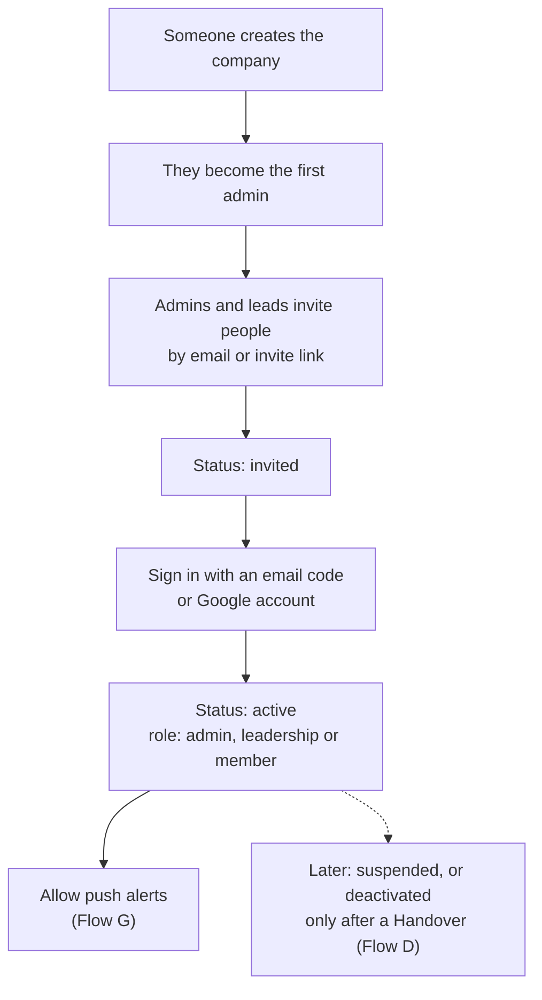

Figure 17. Signing in and joining a company.

## Setting up a company (Proposed)

When someone chooses "Create a company", HopFlows walks them through five short steps before anyone else is invited. People who join an existing company never see these steps: they go from the invite to Welcome and Today.

1. **Company:** name, country, time zone, working days and hours a day. The country loads that year's public holidays. The defaults are Monday to Friday, 8 hours a day.
2. **Departments:** each department and its lead. A department can be added without a lead and get one later. Each has an "Others can see our work" switch, on by default (see §04).
3. **People:** paste work emails or upload a CSV, then set each person's department and role (member, leadership or admin). An invite link can be copied instead.
4. **Products (optional):** the company's apps or services, so Goals and reports can be split by product. Most pilot companies can skip this.
5. **Check and invite:** totals for departments, people and holidays, and what each person sees first. Invites go out only when the admin presses Send.

- Every step is saved as the admin goes. Steps 2–4 can be skipped, and "Finish later" works on any step; a "Finish setup" card stays on the admin's home screen until all five are done.
- Nothing is sent before step 5, so the team gets their invites together and nobody signs in to an empty company.
- Everything set here can be changed later in Admin: People, Holiday calendars, and Products & teams.
- After the invites: employees see First steps with Punh Punh, then Today; leads also see "Plan week" on Needs you.

## Looking after data

- History is never edited. If a person asks for their data to be deleted, their profile is removed and their name in the history is replaced with a made-up name, so reports still add up.
- History and locked plans are kept while the company uses HopFlows. A company can download its data, and ask for it to be deleted when it leaves.
- Telegram and other chat apps are outside services: they get only the information allowed in §05, and the company can turn any channel off.
- Where the data is stored, and any promises about which country it stays in, are decided before the first paying customer.

# Change log

**v1.1, 15 October 2026 (updated 20 October)**

- English is the default language; other languages, such as Khmer, can be added later (17 October).
- Chat apps moved to a later stage: the first version sends alerts by push (phone and browser) and the in-app inbox; Telegram, Slack and Microsoft Teams come later with the same messages and buttons (17 October).
- "Seems urgent" added to Add Work: a hint for the lead, who still decides real urgency when sorting (17 October).
- After a full review of the web screens: the lead's home is "Needs you", the owner or lead removes Blocked with Unblock, admins manage products and departments, and the blueprint points to the design canvas (17 October).
- After the design critique (Proposed): locking a week asks for confirmation and can be undone for 10 minutes; a leave request can be withdrawn while it waits (17 October).
- "My requests" renamed "Requests I sent", so it is clear these are things a person asked their lead to look at (17 October).
- "Task for me" (Proposed): anyone can add a Task for themselves without approval; work for others still goes to the lead as a request (17 October).
- Checklist steps can be added while creating a Task (17 October).
- Add Work opens on Task for me; asking the lead is the second choice (17 October).
- Other departments' work can be seen read-only, without workload or reports; admins can close a department (Proposed, 20 October).
- Company setup (Proposed): whoever creates a company is walked through company details, departments, people and optional products, and invites are sent together at the end (20 October).
- After the lead-flow review (Proposed): approving leave first shows its effect on the person's week and lets the approver give away or move the Tasks due then; locking a week warns about leave requests still waiting but allows the lock; Handover warns when a receiver is on leave (20 October).
- After the third leader-flow review (Proposed): each Goal gets one verdict sentence instead of two coloured pills; a Goal page lists all open flags, including the leader's own, with their notes; Escape closes panels, and clearing a flag or asking for an update can be undone (21 October).
- After the second leader-flow review (Proposed): every Goal card and flag line names its owner and who to ask; a flag open 3 weeks becomes a leader decision; approving a Goal shows the department's current load; a Goal page shows one status pill for its most serious flag and works out pace from the latest result; a leader's own flag needs a note to set and to clear; each Goal card marks where its result needs to be by now and cards are sorted most serious first (21 October).
- After the third pass on the leader flow (Proposed): a leader's Reports opens the company view; on a Goal's page, Update result shows the new percentage before saving and Set flag uses the same reason types as Deliverables, both with Undo (21 October).
- After the second pass on the leader flow (Proposed): Goals can be filtered by flag, product and department; the weekly summary keeps a list of earlier summaries, saves as PDF, and says when a holiday moves it to the next working day; on phones, decisions come right after the Goal count (21 October).
- After the first leader-flow review (Proposed): decisions waiting open in place on the Goals page and from the weekly summary, with Approve or Send back for a Goal and a choice of date or scope for an off-track Deliverable; a Goal's page shows why it is flagged (reason, note, who set it and when, back-on-track date) with a way to ask for an update, and keeps whether the result is on pace apart from whether delivery is at risk (21 October).
- After the fifth lead-flow review (Proposed): Handover can put an item back in Ready to plan with no owner; hours are always written as planned of time to plan (21 October).
- After the fourth lead-flow review (Proposed): the locked plan counts waiting leave and open handovers, so every screen shows week 43 as it will really look; work can still be moved after locking and is recorded as a change (21 October).
- After the third lead-flow review (Proposed): the lock check lets the lead move an overloaded person's work in place; the weekly plan keeps one list of the week's changes; Handover receivers are picked per item with the load after the move; a postponed request gets a return date (20 October).
- After the second lead-flow review (Proposed): every place that moves work to someone shows how busy they would be after the move and suggests whoever has the most room; a request that looks like an open Task starts on Merge; a handover can be undone for 10 minutes (20 October).
- Mascot renamed from Hop to Punh Punh (14 October).
- App icon chosen: Punh Checklist, with usage rules in §11 (15 October).
- First version split into "pilot core" and "soon after"; later-stage features (Workload view for future weeks, temporary Handover, suggested risk flags) marked in the flows and special cases.
- Rules for statuses, Confidential Task access, review and blocked markers, giving rights to named people, work schedules, time split across departments, task sizes, time zones, sorting and postponing requests.
- Rules for carrying work over, weeks never locked, clearing flags, who gets urgent alerts next, snooze, people in several companies, handover receivers and overlapping time off.
- Measures, time words and pilot targets written out.
- The streak no longer counts just starting work.
- Special cases grouped by topic; all default numbers kept in §14; the life of a Task moved before planning.
- New §15 Sign-in, access and data.
- Words on screen: Add Work (employees), Incoming Queue and Sort (leads); "intake" only in reports.
- The blueprint now covers business and design rules only. The data model and engineering rules moved to `HopFlows_Technical_Design_v1.1.md`.
- Gap fixes (Proposed): updates to request senders, weekly summary for leaders, four standard reports with downloads, week status, leave requests and approval, repeating daily work (moved from a later stage into the first version), working offline and search.
- List, Board and Table views added for full work lists (Proposed).
- Flow diagrams added: the life of a Task, a map of who starts which flow, Flows A–J, Board dragging, working offline, and signing in.
- Rewritten in simple, everyday language. Words changed: "baseline" → locked plan, "cycle" → week, "capacity" → time, "Triage" → Sort, "heatmap" → Workload view, "KPI" → measure.

**v1.0, 10 October 2026:** first version.

---

*HopFlows / End of Blueprint*
